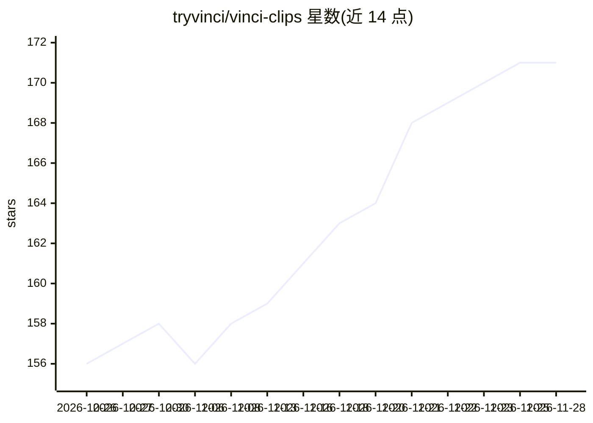

# tryvinci/vinci-clips

⭐ 171 · TypeScript · NOASSERTION · 推送 2026-11-04 · [GitHub](https://github.com/tryvinci/vinci-clips) · [官网](https://tryvinci.com/clips) · 个人维护

**自托管平台：把长视频自动切成带字幕的社交媒体竖屏短片**

用户上传视频（≤2 GB）或粘贴 YouTube 链接后，平台通过 FFmpeg 抽取音频，Gemini 返回带说话人标签的词级时间戳并建议可发布片段，再由 FFmpeg 渲染剪辑；face-api.js 人脸检测用于 9:16 竖屏取景，支持 5 种字幕样式烧录与主播画中画竖排布局。前端 Next.js、后端 Express，转录与片段元数据存于 JSON 文件，无数据库；需 Node.js 18+、FFmpeg 和一个 Gemini API key，支持 docker-compose 部署。AGPL-3.0 许可，修改版对外服务须公开变更。

## 筛选速览

| 维度 | 判定 | 备注 |
|---|---|---|
| AI 角色 | `ai-native` | 本体是模型或模型工具 |
| 许可风险 | `none` | NOASSERTION |
| 部署形态 | `self-host` | docker 或自建部署 |
| 模型依赖 | — | README 未给出锁定关系 |
| 硬件要求 | — | 无带数字的原话,不猜 |
| 安装摩擦 | `low` | 无编译、无系统依赖或容器化 |
| 成熟度 | — | 结构信号不足 |

## 能力要点

- Gemini 转录并建议片段，FFmpeg 完成剪辑与字幕烧录
- face-api.js 人脸检测实现 9:16 自动取景
- 5 种字幕样式与主播/游戏画面竖排布局
- JSON 文件存储，无需数据库，视频文件留在本地

## 适用场景

- 把播客或长视频批量切成 Shorts/Reels 竖屏短片
- 自托管环境下处理视频且不依赖云存储
- 给游戏录像加 webcam 分屏并转成竖屏内容

## 场景标签

`视频生成` · 领域:内容生成

## 证据(README 行号)

> L3: Turn a long video into short vertical clips with captions. Self-hosted, open source (AGPL-3.0), runs on your machine
> L20: - **Transcribe.** FFmpeg pulls the audio, Gemini returns word-level timestamps with speaker labels. Model is set by
> L31: Next.js frontend (3000)  ->  Express API (8080)  ->  FFmpeg + Gemini API

## 星数曲线

2026-10-26 156 → 2026-11-28 171（+15）

---
*卡片 v1 · prompt 1.4 · 生成 2026-11-26 · 置信度 high · 依据 README sha `01b56197efa4` · [字段定义](../../DATASET.md)*
