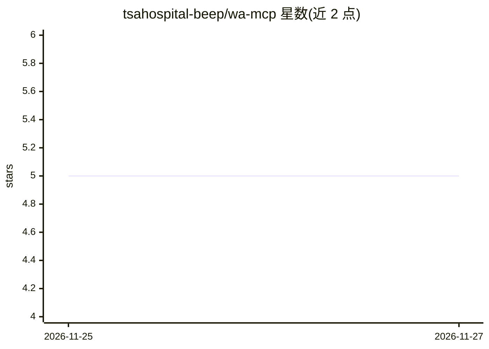

# tsahospital-beep/wa-mcp

⭐ 5 · Python · MIT · 推送 2026-11-23 · [GitHub](https://github.com/tsahospital-beep/wa-mcp) · [官网](https://tsahospital-beep.github.io/wa-mcp/) · 个人维护

**本地 MCP 服务器：让 Claude/Cursor 等 AI 助手搜索、读取、发送 WhatsApp 消息**

由 Go 桥接器与 Python MCP 服务器组成：桥接器通过扫码/配对码链接 WhatsApp 账号，存储消息与媒体并加密落盘；MCP 服务器以 11 个核心工具（另有多组可选工具集）向客户端暴露搜索、读取、发送、语音转写、OCR、文档读取与日程汇总等能力。支持多账号、聊天导入、Webhook、远程 HTTP 访问（OAuth 2.1）、Docker 部署与可选后台 AI 提供方。发送默认关闭并需逐条确认。

## 筛选速览

| 维度 | 判定 | 备注 |
|---|---|---|
| AI 角色 | `ai-ecosystem` | LLM/agent 周边工具 |
| 许可风险 | `permissive` | MIT |
| 部署形态 | `desktop` | 安装包/桌面程序 |
| 模型依赖 | local-ok | 支持本地模型 |
| 硬件要求 | `cpu-ok` | |
| 安装摩擦 | `medium` | 含编译或系统依赖之一 |
| 成熟度 | — | 结构信号不足 |

## 能力要点

- 通过 MCP 协议向 Claude、Cursor、VS Code 等客户端暴露 WhatsApp 工具
- 语音转写支持 faster-whisper、openai-whisper、whisper.cpp 及 OpenAI 兼容端点等可插拔后端
- 本地 OCR（tesseract/RapidOCR）读取截图文本并纳入搜索
- 数据库默认加密，密钥存于操作系统密钥库

## 适用场景

- 让 AI 助手代为查找和总结 WhatsApp 聊天记录
- 转写语音消息并搜索其中的内容
- 在本地自托管环境下管理多个 WhatsApp 号码的消息

## 场景标签

`AI 助手` `语音识别` `OCR` · 领域:对话与助手

## 证据(README 行号)

> L11:  WhatsApp MCP for AI assistants: a local bridge and MCP server to search, read and send WhatsApp messages from Clau
> L114:  Architecture: the bridge (Go) connects to WhatsApp and keeps a local database and an HTTP API. The MCP server (Py
> L192: The default `core` toolset exposes 11 tools for checking bridge status, finding contacts and chats,

## 星数曲线

2026-11-25 5 → 2026-11-27 5（+0）

---
*卡片 v1 · prompt 1.4 · 生成 2026-11-24 · 置信度 high · 依据 README sha `18657c1b6976` · [字段定义](../../DATASET.md)*
