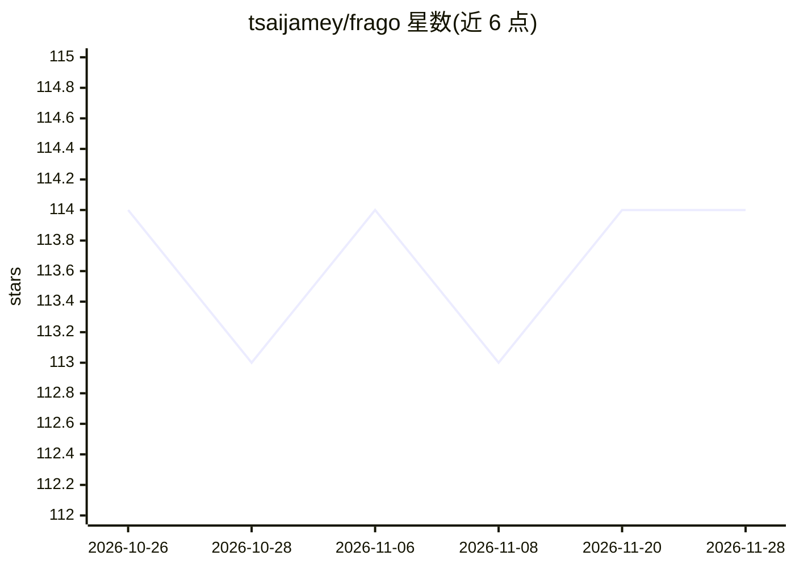

# tsaijamey/frago

⭐ 114 · Python · MIT · 推送 2026-11-27 · [GitHub](https://github.com/tsaijamey/frago) · [官网](https://github.com/tsaijamey/frago) · 个人维护

**在本地运行角色化 AI 数字员工团队并管理共享上下文的自动化基础设施**

frago 是一个多运行时的 AI agent 自动化基础设施，在用户本机组织 PM、开发者、设计师等角色化“数字员工”，员工间通过本地文件、报告与会话历史作为共享上下文自动交接。内置 CoreAgent 执行引擎，也可绑定 Claude Code、Codex、OpenCode 等外部引擎并随时切换。提供登录态浏览器标签页与后台虚拟桌面两种工作区、关键节点决策卡、以及可冻结为确定性代码零 token 重跑的 Recipe 系统。提供一键安装脚本、PyPI 与源码安装方式，支持 macOS/Windows/Linux，MIT 许可。

## 筛选速览

| 维度 | 判定 | 备注 |
|---|---|---|
| AI 角色 | `ai-ecosystem` | LLM/agent 周边工具 |
| 许可风险 | `permissive` | MIT |
| 部署形态 | `library` | 以包/库形式分发 |
| 模型依赖 | — | README 未给出锁定关系 |
| 硬件要求 | — | 无带数字的原话,不猜 |
| 安装摩擦 | `low` | 无编译、无系统依赖或容器化 |
| 成熟度 | — | 结构信号不足 |

## 能力要点

- 角色化数字员工与可切换引擎：内置 CoreAgent，可绑定 Claude Code/Codex/OpenCode
- 4 层本地上下文：产物台账、领域知识、跨会话搜索、companion 护栏
- 登录态浏览器标签页与后台虚拟桌面两种非侵入工作区
- Recipe 系统将工作流冻结为确定性代码，0 token 重跑

## 适用场景

- 让多个角色化 agent 在本机协作完成长周期项目并自动交接
- 复用已登录的浏览器配置执行自动化网页任务
- 把重复工作流固化为可零成本重跑的确定性脚本

## 场景标签

`浏览器自动化` `多智能体` · 领域:Agent 开发

## 证据(README 行号)

> L38: Each digital employee has a defined role, dedicated data ledger, and automatic peer-handoff rules. frago ships with
> L45:  Companion Guardrails (<code>frago-core</code> + <code>LightAgent</code>): Automatically verify folder rules, role 

## 星数曲线

2026-10-26 114 → 2026-11-28 114（+0）

---
*卡片 v1 · prompt 1.4 · 生成 2026-11-28 · 置信度 high · 依据 README sha `d907bf79ae4b` · [字段定义](../../DATASET.md)*
