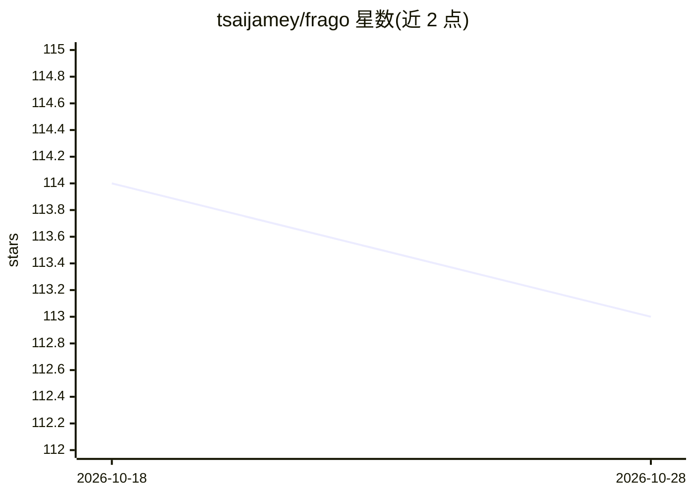

# tsaijamey/frago

⭐ 113 · Python · MIT · 推送 2026-10-28 · [GitHub](https://github.com/tsaijamey/frago) · [官网](https://github.com/tsaijamey/frago) · 个人维护 · 中文 README

**面向 CLI AI agent 的宿主运行时：浏览器控制、持久记忆与可复用 Recipe 工作流**

frago 定位为 AI agent 操作系统（Agent OS），本体不产出模型，而是将 Claude Code、codex、opencode、agy 等 CLI agent 作为执行引擎，在其上提供宿主环境：CDP 原生浏览器控制、虚拟桌面、长期持久记忆（决策/工件/运行痕迹/交接）、把推理跑通的流程冻结为零 token 的确定性 Recipe 代码、多 agent 协调与调度。人类侧提供统一 Web Console，将异构 agent 的会话记录归一化为统一列表与动作时间线，支持多模型凭证集中管理。以 Python 包形式经 PyPI 分发，含 CLI 与守护进程。限制：Recipe 由 agent 现场编写而非内置；示例均为作者私人机器内容。

## 筛选速览

| 维度 | 判定 | 备注 |
|---|---|---|
| AI 角色 | `ai-ecosystem` | LLM/agent 周边工具 |
| 许可风险 | `viral` | MIT |
| 部署形态 | `library` | 以包/库形式分发 |
| 模型依赖 | — | README 未给出锁定关系 |
| 硬件要求 | — | 无带数字的原话,不猜 |
| 安装摩擦 | `medium` | 含编译或系统依赖之一 |
| 成熟度 | — | 结构信号不足 |

## 能力要点

- 原生 CDP 浏览器控制，驱动用户真实登录态的浏览器 profile
- Recipe 系统：把 agent 跑通的流程冻结为确定性代码，重跑零 token
- 长期记忆解耦为决策/工件/运行痕迹/交接，替代一次性上下文堆砌
- 统一 Console 归一化异构 CLI agent 的会话记录，支持 1,000+ 会话管理

## 适用场景

- 让 CLI agent 在真实浏览器和桌面上执行带登录态的自动化任务
- 把反复调通的 agent 工作流固化为一键重跑的工具
- 统一管理多个 CLI agent（Claude Code/opencode 等）的会话与凭证

## 场景标签

`浏览器自动化` `Agent 记忆` `多智能体` `工作流自动化` · 领域:Agent 开发

## 证据(README 行号)

> L32: frago does not produce proprietary language models, nor does it maintain a closed conversational loop. It treats Cl
> L34: frago provides the full host runtime above the engine — giving agents real browser and desktop automation, long-ter
> L45: - **Recipes determine what the agent doesn't need to repeat**: Procedures proven through reasoning are frozen into 

## 星数曲线

2026-10-18 114 → 2026-10-28 113（-1）

---
*卡片 v1 · prompt 1.4 · 生成 2026-10-23 · 置信度 mid · 依据 README sha `9dcf0330039b` · [字段定义](../../DATASET.md)*
