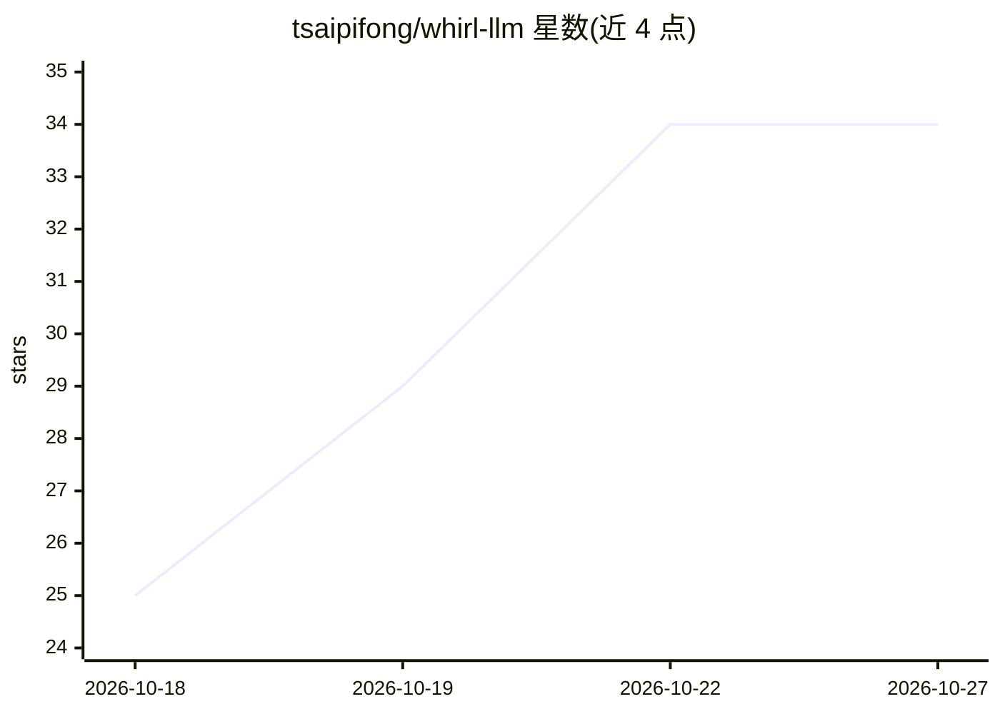

# tsaipifong/whirl-llm

⭐ 34 · C++ · Apache-2.0 · 推送 2026-10-26 · [GitHub](https://github.com/tsaipifong/whirl-llm) · 个人维护 · 中文 README

**Windows 原生 C++/HIP 的 AMD GPU LLM 推理引擎，解压即用**

面向 AMD Radeon 8060S（Ryzen AI Max+ 395 iGPU）与 Radeon AI PRO R9700（RDNA 4, 32GB）的开源（Apache-2.0）LLM 推理引擎，全部内核为原生 C++/HIP，无需 WSL、Docker 或 ROCm 安装，仅需 AMD 驱动。发布 zip 包解压运行，支持 Swift-1.5 27B MXFP4（dense）与 Ornith-1.5-35B-A3B MXFP4（MoE）两个模型，提供 precise/balance/fast 三种数值模式，支持最长约 250k token 的提示，采用 MTP+n-gram 投机解码，README 含与 llama.cpp ROCm/Vulkan 构建的对比基准。限制：每进程一块 GPU，要求 Windows 11 64 位，8060S 需在 BIOS/Armoury Crate 中设置专用显存。

## 筛选速览

| 维度 | 判定 | 备注 |
|---|---|---|
| AI 角色 | `ai-ecosystem` | LLM/agent 周边工具 |
| 许可风险 | `permissive` | Apache-2.0 |
| 部署形态 | `desktop` | 安装包/桌面程序 |
| 模型依赖 | — | README 未给出锁定关系 |
| 硬件要求 | — | 无带数字的原话,不猜 |
| 安装摩擦 | `medium` | 含编译或系统依赖之一 |
| 成熟度 | — | 结构信号不足 |

## 能力要点

- 原生 C++/HIP 内核，无需 WSL/Docker/ROCm，仅需 AMD 驱动
- 支持 Radeon 8060S 与 Radeon AI PRO R9700 两款 GPU
- 提供 precise/balance/fast 三种数值模式，提示最长约 250k token
- MTP + n-gram 投机解码，R9700 上 prefill 走 RDNA 4 fp8 矩阵单元

## 适用场景

- 在 Windows 上为 AMD Radeon 8060S/R9700 本地运行 MXFP4 模型
- 长文档问答与编码 agent 会话的本地推理
- 不装 ROCm/WSL 环境直接解压运行 LLM 服务

## 场景标签

`推理引擎` · 领域:训练与推理

## 证据(README 行号)

> L10: WHIRL is an open-source (Apache-2.0) LLM inference engine for AMD GPUs on Windows: native C++/HIP, every kernel inc
> L109: |GPU|**Radeon 8060S** (RDNA 3.5, gfx1151, the AMD Ryzen AI Max+ 395 iGPU) or **AMD Radeon AI PRO R9700** (RDNA 4, 

## 星数曲线

2026-10-18 25 → 2026-10-27 34（+9）

---
*卡片 v1 · prompt 1.4 · 生成 2026-10-25 · 置信度 high · 依据 README sha `76978da5608b` · [字段定义](../../DATASET.md)*
