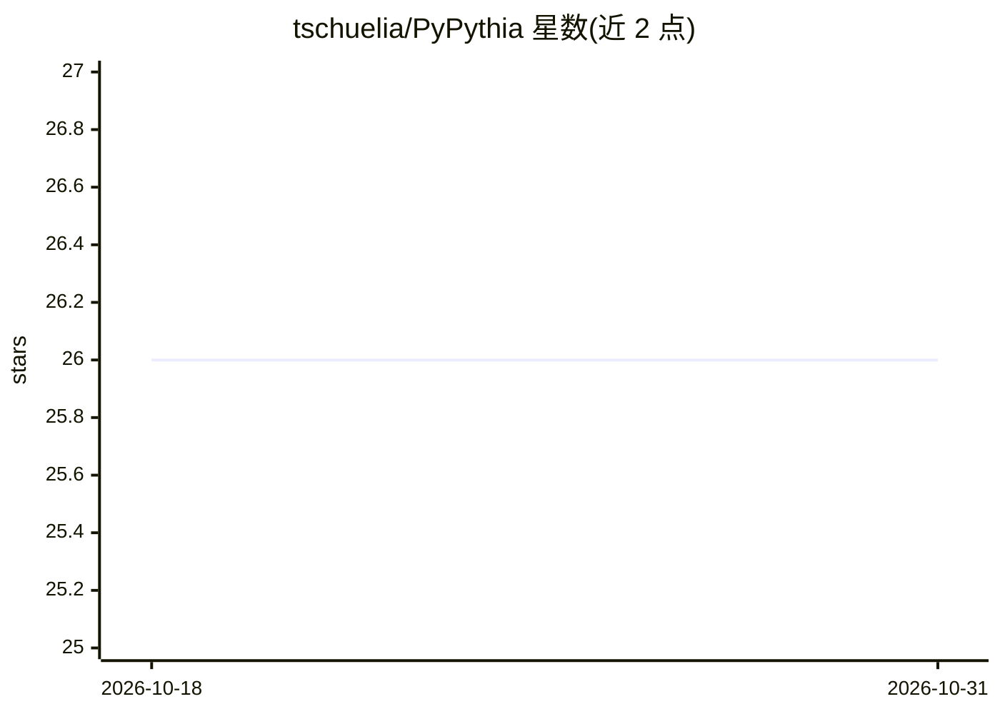

# tschuelia/PyPythia

⭐ 26 · Python · GPL-3.0 · 推送 2026-09-16 · [GitHub](https://github.com/tschuelia/PyPythia) · [官网](https://tschuelia.github.io/PyPythia/master/) · 个人维护

**预测多序列比对系统发育分析难度的 Python 库**

面向系统发育学研究者与生物信息开发者的 Python 库：在启动最大似然（ML）建树推断之前，预测多序列比对（MSA）数据集的分析难度，速度远快于用 RAxML-NG 推断多棵 ML 树来评估。支持 DNA、氨基酸与形态学数据（Phylip 与 FASTA 格式），可用于评估数据信号与不确定性、按难度选择合适搜索算法。模型自 v1 起从随机森林改为 LightGBM 梯度提升树；另有依赖 Coraxlib 的 C 库版本供集成到系统发育工具中。论文发表于 MBE（2022），更新有 BioRxiv 预印本。

## 筛选速览

| 维度 | 判定 | 备注 |
|---|---|---|
| AI 角色 | `ai-native` | 本体是模型或模型工具 |
| 许可风险 | `viral` | GPL-3.0 |
| 部署形态 | `None` |  |
| 模型依赖 | — | README 未给出锁定关系 |
| 硬件要求 | — | 无带数字的原话,不猜 |
| 安装摩擦 | `low` | 无编译、无系统依赖或容器化 |
| 成熟度 | — | 结构信号不足 |

## 能力要点

- ML 建树前预测 MSA 数据集分析难度
- 支持 DNA、氨基酸与形态学数据（Phylip/FASTA 格式）
- v1 起改用 LightGBM 梯度提升树回归器
- 另提供功能相同的 C 库版本（依赖 Coraxlib）

## 适用场景

- 系统发育分析前预估数据集难度与预期不确定性
- 按难度等级选择合适的树搜索算法
- 在系统发育工具中集成难度预测功能（C 库）

## 场景标签

 · 领域:生物信息学/系统发育学

## 证据(README 行号)

> L6: Pythia is a lightweight Python library to predict the difficulty of Multiple Sequence Alignments (MSA).
> L7: Phylogenetic analyzes under the Maximum-Likelihood (ML) model are time and resource intensive. To adequately capture

## 星数曲线

2026-10-18 26 → 2026-10-31 26（+0）

---
*卡片 v1 · prompt 1.4 · 生成 2026-10-26 · 置信度 high · 依据 README sha `bc0694323518` · [字段定义](../../DATASET.md)*
