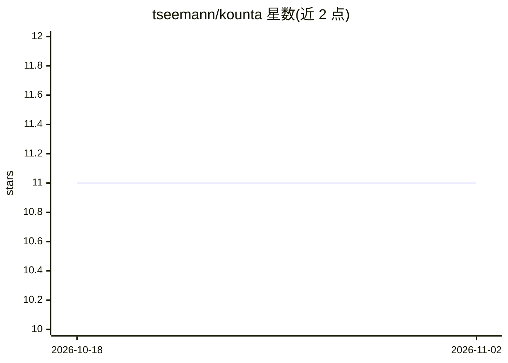

# tseemann/kounta

⭐ 11 · Perl · GPL-3.0 · 推送 2026-01-17 · [GitHub](https://github.com/tseemann/kounta) · 个人维护

**从多组基因组数据生成唯 k-mer 计数矩阵的命令行工具**

Perl 编写的生物信息学命令行工具：输入 N 个样本的 contigs（FASTA）或 reads（FASTQ.gz），基于 kmc 进行 k-mer 计数，再用 sort/paste/cut/join 等 Unix 工具流式合并，生成 M 行 N+1 列的制表符分隔计数矩阵（M 为跨样本唯 k-mer 数）。无需将全部数据载入内存，可用 --threads 和 --ram 控制资源。面向基因组学与 GWAS 数据分析用户，通过 conda（bioconda 频道）安装。

## 筛选速览

| 维度 | 判定 | 备注 |
|---|---|---|
| AI 角色 | `ai-ecosystem` | LLM/agent 周边工具 |
| 许可风险 | `viral` | GPL-3.0 |
| 部署形态 | `None` |  |
| 模型依赖 | — | README 未给出锁定关系 |
| 硬件要求 | — | 无带数字的原话,不猜 |
| 安装摩擦 | `low` | 无编译、无系统依赖或容器化 |
| 成熟度 | — | 结构信号不足 |

## 能力要点

- 输入 N 个 FASTA/FASTQ.gz 样本，输出多样本唯 k-mer 计数矩阵
- 依赖 kmc 计数与 Unix 标准工具，流式处理无需全部载入内存
- 支持 --threads/--ram 参数控制运行资源
- 提供 core k-mer 提取与二元化（presence/absence）的操作示例

## 适用场景

- 对多个细菌基因组样本构建 k-mer 计数矩阵用于比较分析
- GWAS 前的多样本唯 k-mer 特征矩阵生成
- 提取样本共有的 core k-mer 集合

## 场景标签

 · 领域:生物信息学/基因组学

## 证据(README 行号)

> L9: Build a multi-genome unique k-mer count matrix
> L18: It relies on `kmc` for efficient k-mer counting, then uses standard

## 星数曲线

2026-10-18 11 → 2026-11-02 11（+0）

---
*卡片 v1 · prompt 1.4 · 生成 2026-11-01 · 置信度 mid · 依据 README sha `70a5b2056ee1` · [字段定义](../../DATASET.md)*
