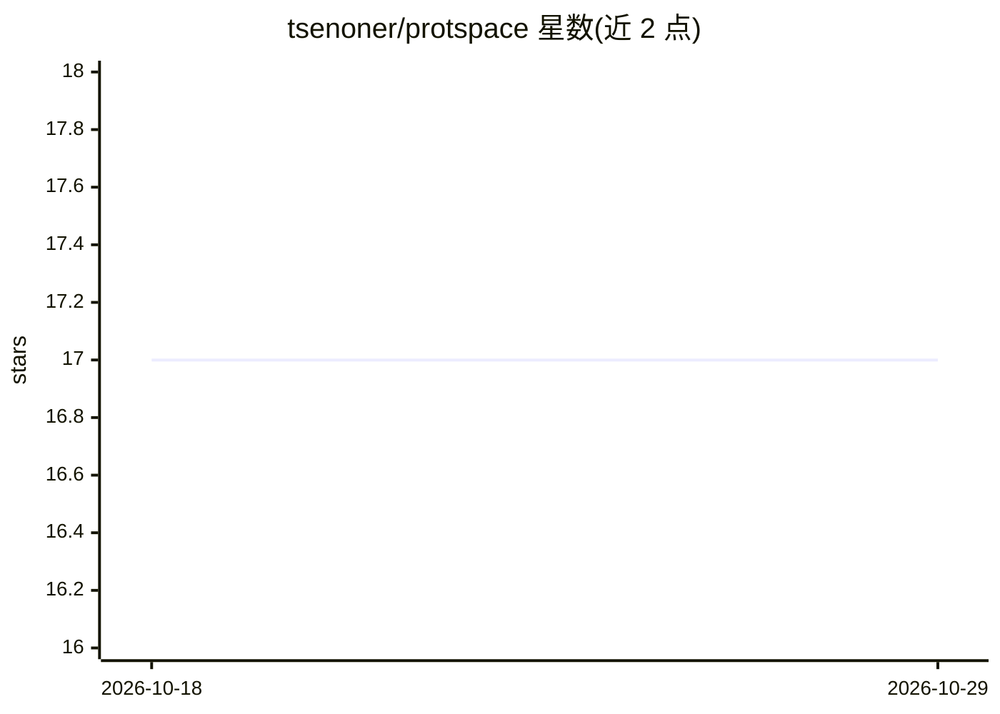

# tsenoner/protspace

⭐ 17 · TypeScript · MIT · 推送 2026-10-28 · [GitHub](https://github.com/tsenoner/protspace) · [官网](https://protspace.app/) · 组织维护

**浏览器中探索蛋白质语言模型嵌入的交互式可视化工具**

面向生物信息学科研用户：将蛋白质语言模型（pLM）嵌入投影为交互式地图，展示序列相似性遗漏的关系；支持叠加生物学注释、以置信度分数将标签转移至未注释蛋白（EAT）、查看 3D 结构并导出版面级图片。数据以 .parquetbundle 形式加载，浏览器端本地运行，文件不上传（.fasta 即时准备路径除外，其需上传序列至 ProtSpace 后端计算嵌入）。可通过 protspace.app 在线使用、Google Colab 或 pip 安装 Python 包生成本地 bundle。

## 筛选速览

| 维度 | 判定 | 备注 |
|---|---|---|
| AI 角色 | `ai-ecosystem` | LLM/agent 周边工具 |
| 许可风险 | `permissive` | MIT |
| 部署形态 | `library` | 以包/库形式分发 |
| 模型依赖 | — | README 未给出锁定关系 |
| 硬件要求 | — | 无带数字的原话,不猜 |
| 安装摩擦 | `low` | 无编译、无系统依赖或容器化 |
| 成熟度 | — | 结构信号不足 |

## 能力要点

- pLM 嵌入降维投影为交互式地图，支持叠加生物学注释
- EAT 标签转移：为未注释蛋白分配标签并给出置信度
- 全流程客户端运行，bundle 文件不出本机
- 可从 HDF5 嵌入构建 bundle，导出版面级图片

## 适用场景

- 把蛋白质嵌入投影成地图，发现序列相似性发现不了的关系
- 为未注释蛋白质做标签转移并获得置信度
- 在不本地安装的情况下通过 Colab 或网页版快速准备和浏览数据

## 场景标签

`科研工具` · 领域:学习与行业

## 证据(README 行号)

> L12: ProtSpace is a free, in-browser tool for exploring protein language model (pLM) embeddings. Project embeddings into
> L35: See the ProtSpace Python package for the full CLI (annotation transfer, quality metrics, multiple pLMs, and more).

## 星数曲线

2026-10-18 17 → 2026-10-29 17（+0）

---
*卡片 v1 · prompt 1.4 · 生成 2026-10-29 · 置信度 high · 依据 README sha `fd6b6b86980f` · [字段定义](../../DATASET.md)*
