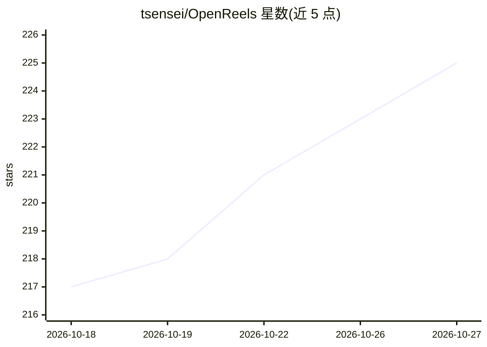

# tsensei/OpenReels

⭐ 225 · TypeScript · MIT · 推送 2026-04-10 · [GitHub](https://github.com/tsensei/OpenReels) · [官网](http://openreels.tsensei.dev/) · 个人维护

**一条命令把任意主题生成为可发布的竖屏短视频的 AI 流水线**

开源的端到端短视频生成流水线：输入主题后自动完成网络检索、脚本撰写、TTS 配音、AI 图像/视频生成、AI 配乐（Lyria 或内置 25 首曲库）、动画字幕，并用 Remotion 合成为竖屏 MP4。各环节支持多供应商切换（Claude/GPT/Gemini/OpenRouter、ElevenLabs/Kokoro 等），本地 Kokoro 路径可零 API key 运行。提供 Web UI（含实时流水线可视化）、REST API、Docker 与 CLI；执行前展示成本预估并需确认，AI 评审低于阈值会重跑。需自带各供应商 API key，本地开发需 Node.js 22+、pnpm、ffprobe。

## 筛选速览

| 维度 | 判定 | 备注 |
|---|---|---|
| AI 角色 | `ai-native` | 本体是模型或模型工具 |
| 许可风险 | `permissive` | MIT |
| 部署形态 | `self-host` | docker 或自建部署 |
| 模型依赖 | locked-api |  |
| 硬件要求 | — | 无带数字的原话,不猜 |
| 安装摩擦 | `low` | 无编译、无系统依赖或容器化 |
| 成熟度 | — | 结构信号不足 |

## 能力要点

- 研究→脚本→配音→视觉→音乐→字幕→合成的全自动多阶段流水线
- LLM/TTS/图像/视频/音乐各环节多供应商可切换，含免费本地 Kokoro TTS 路径
- 14 种视觉风格模板与按目标平台（YouTube/TikTok/Instagram）适配
- 花费前展示成本明细并确认，渲染后按真实 token 用量结算

## 适用场景

- 输入一个主题就产出带配音、配乐、字幕的竖屏短视频
- 运营多个短视频账号时批量生产不同视觉风格的内容
- 通过 Web UI 实时观看生成各阶段进展并下载成品

## 场景标签

`视频生成` · 领域:内容生成

## 证据(README 行号)

> L10: Open-source AI pipeline that turns any topic into a publish-ready YouTube/Instagram/TikTok Short. One command. Rese
> L67: |**LLM**|Anthropic Claude, OpenAI GPT, Google Gemini, OpenRouter (300+ models), any OpenAI-compatible endpoint|

## 星数曲线

2026-10-18 217 → 2026-10-27 225（+8）

---
*卡片 v1 · prompt 1.4 · 生成 2026-10-22 · 置信度 mid · 依据 README sha `a1ce6784f561` · [字段定义](../../DATASET.md)*
