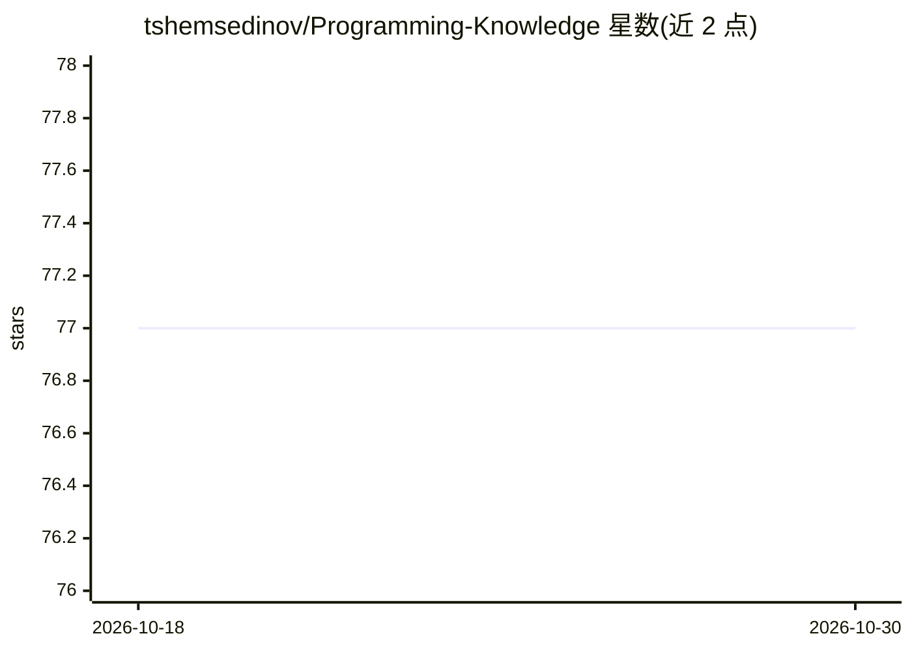

# tshemsedinov/Programming-Knowledge

⭐ 77 · 推送 2026-04-16 · [GitHub](https://github.com/tshemsedinov/Programming-Knowledge) · [官网](https://youtube.com/TimurShemsedinov) · 个人维护

**面向程序员的编程知识学习要点清单**

由 Timur Shemsedinov 维护的程序员知识要点清单，面向 JavaScript/TypeScript 与 Web 开发者，覆盖 2026 年应掌握的编程概念：数据结构、类型系统、函数式组合、并发异步、测试、多范式与元编程等约 35 个主题，其中包含 AI 辅助工程一项。README 为纯文字清单，不含代码、安装或运行方式；作者提到这些内容应只占工程师技能的 30%，剩余 70% 内容尚未补充。

## 筛选速览

| 维度 | 判定 | 备注 |
|---|---|---|
| AI 角色 | `ai-knowledge` | 知识聚合/清单类 |
| 许可风险 | `none` | — |
| 部署形态 | `None` |  |
| 模型依赖 | — | README 未给出锁定关系 |
| 硬件要求 | — | 无带数字的原话,不猜 |
| 安装摩擦 | `low` | 无编译、无系统依赖或容器化 |
| 成熟度 | — | 结构信号不足 |

## 能力要点

- 列出约 35 项编程知识要点（数据结构、类型系统、并发、测试等）
- 提及 AI 辅助工程作为技能项之一
- 以 JavaScript/TypeScript 和 Web 为主要语境

## 适用场景

- 程序员自查知识盲区，按清单逐项学习
- 团队作为技能参考清单组织学习

## 场景标签

`精选清单` · 领域:学习与行业

## 证据(README 行号)

> L1: # Essential Knowledge for Programmers in 2026
> L39: - AI-assisted engineering

## 星数曲线

2026-10-18 77 → 2026-10-30 77（+0）

---
*卡片 v1 · prompt 1.4 · 生成 2026-10-24 · 置信度 mid · 依据 README sha `806ef902ee9a` · [字段定义](../../DATASET.md)*
