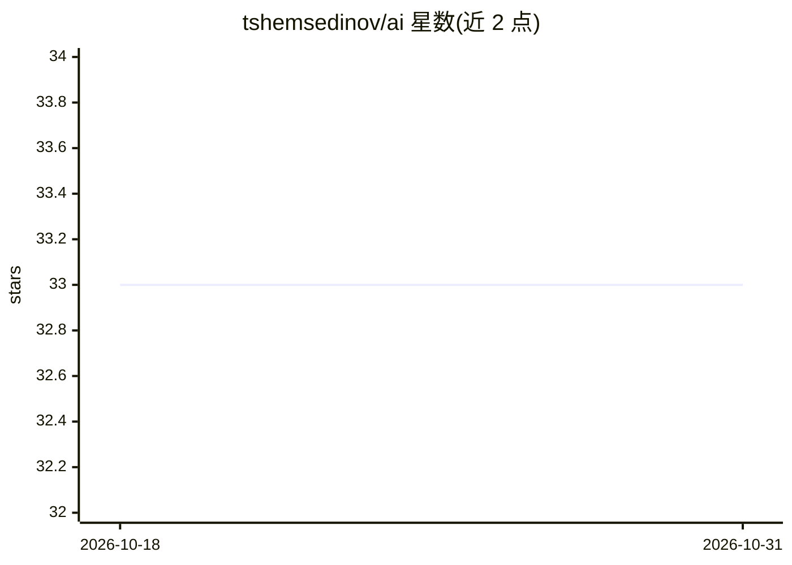

# tshemsedinov/ai

⭐ 33 · 推送 2026-03-22 · [GitHub](https://github.com/tshemsedinov/ai) · 个人维护

**面向程序员与非程序员的 AI 入门与最佳实践指南**

一篇俄语撰写的 AI 使用导论：解释 AI 在搜索创意、学习、办公自动化、表格与代码处理上的用途；按聊天、提示词、推理、规划、工具、Agent、迭代循环划分学习阶段；讨论“空循环”问题——迭代不引入新信息会导致错误固化；给出实践起步建议、术语表（Prompt/Agent/Skills/RAG/Token 等约 25 条）及模型分工建议。适合两类读者循序渐进掌握 Agent 与工具化工作流。

## 筛选速览

| 维度 | 判定 | 备注 |
|---|---|---|
| AI 角色 | `ai-knowledge` | 知识聚合/清单类 |
| 许可风险 | `none` | — |
| 部署形态 | `None` |  |
| 模型依赖 | — | README 未给出锁定关系 |
| 硬件要求 | — | 无带数字的原话,不猜 |
| 安装摩擦 | `low` | 无编译、无系统依赖或容器化 |
| 成熟度 | — | 结构信号不足 |

## 能力要点

- 按 7 个阶段（聊天→提示词→推理→规划→工具→Agent→迭代循环）划分学习路径
- 含约 25 条 AI 术语表（Agent/Skills/RAG/Temperature 等）
- 提出“空循环”问题：迭代无新输入则错误固化
- 给出 Opus/Sonnet 分工的模型使用方案

## 适用场景

- 非程序员了解 AI 能用于哪些日常工作
- 程序员规划从提示词到 Agent 化工作流的学习路径
- 团队讨论 AI 迭代循环中的注意力投入

## 场景标签

`教程课程` `提示工程` · 领域:Agent 开发

## 证据(README 行号)

> L3: > лучшие практики по AI для программистов и непрограммистов
> L21: Базовый путь освоения у всех почти одинаковый. Сначала человек учится ставить задачу и получать результат в чате. З

## 星数曲线

2026-10-18 33 → 2026-10-31 33（+0）

---
*卡片 v1 · prompt 1.4 · 生成 2026-10-25 · 置信度 high · 依据 README sha `29c501bc565b` · [字段定义](../../DATASET.md)*
