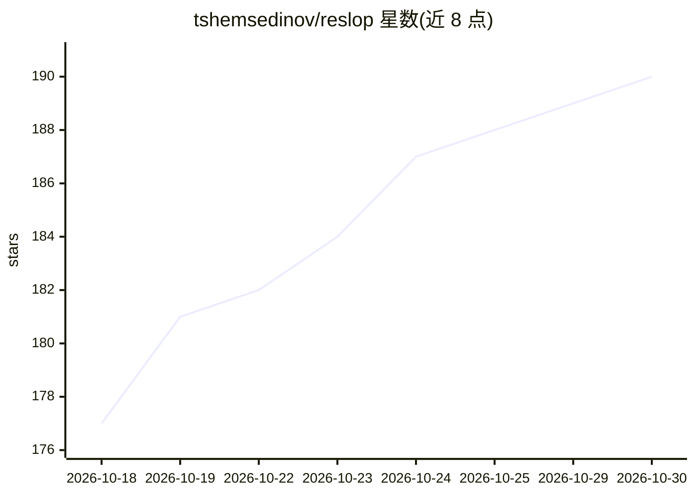

# tshemsedinov/reslop

⭐ 190 · JavaScript · MIT · 推送 2026-10-29 · [GitHub](https://github.com/tshemsedinov/reslop) · [官网](https://reslop.it) · 个人维护

**AI 生成代码的审查与修复计划工具：Review→Plan→Repair→Verify**

面向开发者的终端工具，用于审查 AI 生成的变更并将其转为可掌控的改动：实时仪表盘展示文件、diff、任务、分支、提交与 npm 脚本；支持审查未提交 git diff、指定提交、GitHub PR 与 GitLab MR；可将反馈与代码内提案写入 .plan 目录形成修复计划，并通过 Agent Client Protocol（ACP）在本地 agent（Claude Code、Codex、Cursor 等 12 种）中执行计划；提供面向 agent 的精简测试/lint 报告。npm 全局安装，要求 Node.js>=18.15.0，支持 Linux/macOS/Windows。

## 筛选速览

| 维度 | 判定 | 备注 |
|---|---|---|
| AI 角色 | `ai-ecosystem` | LLM/agent 周边工具 |
| 许可风险 | `permissive` | MIT |
| 部署形态 | `library` | 以包/库形式分发 |
| 模型依赖 | — | README 未给出锁定关系 |
| 硬件要求 | — | 无带数字的原话,不猜 |
| 安装摩擦 | `low` | 无编译、无系统依赖或容器化 |
| 成熟度 | — | 结构信号不足 |

## 能力要点

- 审查 git diff/commit/GitHub PR/GitLab MR 并生成修复计划
- 通过 ACP 在 12 种本地 coding agent 中执行计划
- 面向 agent 的精简测试与 lint 报告（只保留失败与摘要）
- 实时仪表盘：文件、diff、分支、worktree、npm 脚本

## 适用场景

- 审查 AI agent 生成的代码变更并整理修复清单
- 把评审反馈写成结构化计划交由 agent 执行与核验
- 为 agent 精简测试和 lint 输出，减少无关噪音

## 场景标签

`代码审查` · 领域:编码与开发

## 证据(README 行号)

> L13: Open a change, leave findings and a backlog, and prepare a repair plan for the agent.
> L73: reslop runs a plan in an agent over the Agent Client Protocol. An agent is listed as available when the command tha

## 星数曲线

2026-10-18 177 → 2026-10-30 190（+13）

---
*卡片 v1 · prompt 1.4 · 生成 2026-10-22 · 置信度 high · 依据 README sha `41e2a9818dae` · [字段定义](../../DATASET.md)*
