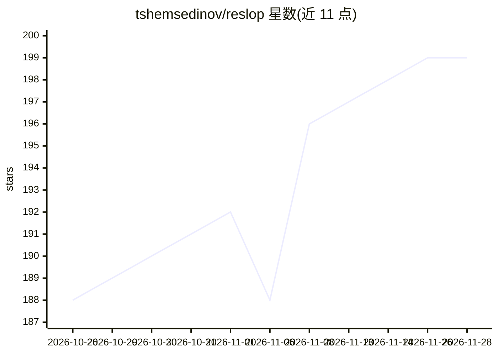

# tshemsedinov/reslop

⭐ 199 · JavaScript · MIT · 推送 2026-11-14 · [GitHub](https://github.com/tshemsedinov/reslop) · [官网](https://reslop.it) · 个人维护

**审查 AI 生成代码并规划修复任务的终端仪表盘**

面向使用 AI 编码 agent 的开发者：提供实时仪表盘查看文件、diff、分支、提交与任务，支持审查未提交的 git diff、指定提交、GitHub PR 或 GitLab MR，并将反馈与 backlog 写成 .plan/ 目录下结构化的修复计划，通过 Agent Client Protocol 在本地 agent 中执行计划。附带精简测试/lint 输出给 agent 读取、冲突解决、npm 依赖审查等功能。需 Node.js >=18.15.0，跨 Linux/macOS/Windows 运行。

## 筛选速览

| 维度 | 判定 | 备注 |
|---|---|---|
| AI 角色 | `ai-ecosystem` | LLM/agent 周边工具 |
| 许可风险 | `permissive` | MIT |
| 部署形态 | `library` | 以包/库形式分发 |
| 模型依赖 | — | README 未给出锁定关系 |
| 硬件要求 | — | 无带数字的原话,不猜 |
| 安装摩擦 | `low` | 无编译、无系统依赖或容器化 |
| 成熟度 | — | 结构信号不足 |

## 能力要点

- 通过 Agent Client Protocol 在 12 种本地 agent 中执行修复计划
- 审查对象覆盖未提交 diff、提交、GitHub PR 与 GitLab MR
- .plan/ Markdown 计划文件带状态机（editing/partial/done）
- 精简测试与 lint 输出为 Markdown 报告供 agent 读取

## 适用场景

- 审查 AI agent 生成的代码改动并留批注与任务
- 为 agent 编写结构化修复计划并跟踪完成状态
- 在终端中集中管理分支、提交、worktree 与 npm 脚本

## 场景标签

`代码审查` · 领域:编码与开发

## 证据(README 行号)

> L34: - Execute the plan in local agents over ACP; continue a session or start a new one
> L85: reslop runs a plan in an agent over the Agent Client Protocol. An agent is listed as available when the command tha
> L3: ## Review AI-generated code and plan changes

## 星数曲线

2026-10-26 188 → 2026-11-28 199（+11）

---
*卡片 v1 · prompt 1.4 · 生成 2026-11-25 · 置信度 high · 依据 README sha `b7e9592aedbc` · [字段定义](../../DATASET.md)*
