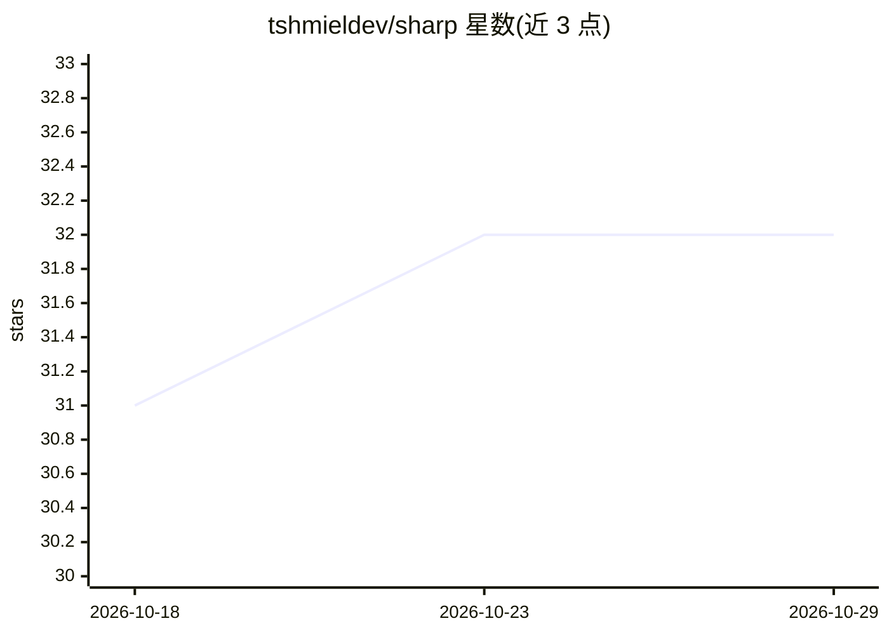

# tshmieldev/sharp

⭐ 32 · TypeScript · MIT · 推送 2026-09-23 · [GitHub](https://github.com/tshmieldev/sharp) · 个人维护

**用自选 LLM 按自然语言规则过滤 X 时间线的浏览器扩展**

面向 X 用户的 Chrome/Firefox 浏览器扩展：用户用自然语言描述想看或不想看的内容，决策模型对每条帖子打分，配合滑杆将帖子折叠为隐藏行。支持按作者规则、屏蔽词预过滤、纠错示例反馈给模型；可经 OpenRouter、Vercel AI Gateway 或 TypeSafe AI 接入分类器，也可改用 OpenAI、Anthropic 或 OpenAI 兼容端点的对话模型。无账户无服务器，API key 存于浏览器直连提供商。另含 YouTube Shorts 隐藏、灰度显示等无模型功能。Firefox 需 140 或更新版本。

## 筛选速览

| 维度 | 判定 | 备注 |
|---|---|---|
| AI 角色 | `ai-native` | 本体是模型或模型工具 |
| 许可风险 | `permissive` | MIT |
| 部署形态 | `None` |  |
| 模型依赖 | locked-api |  |
| 硬件要求 | — | 无带数字的原话,不猜 |
| 安装摩擦 | `low` | 无编译、无系统依赖或容器化 |
| 成熟度 | — | 结构信号不足 |

## 能力要点

- 自然语言描述过滤规则，模型对每条帖子打分并按滑杆隐藏
- 支持 OpenRouter/Vercel AI Gateway/TypeSafe AI 分类器及任意对话模型（含 OpenAI 兼容端点）
- 纠错反馈作为 few-shot 示例送入模型，可按作者设置规则
- 无账户无服务器，API key 仅存于浏览器

## 适用场景

- 过滤 X 时间线上的加密货币宣传、钓鱼互动类内容
- 只保留特定主题（如软件工程）相关的帖子
- 隐藏 YouTube Shorts 与评论区、降低界面色彩干扰

## 场景标签

 · 领域:浏览器扩展/社交媒体工具

## 证据(README 行号)

> L5: Filter your X timeline with an AI model you choose and pay for directly.
> L39: - **A classifier by default.** A decision model scores every post: fast, nearly

## 星数曲线

2026-10-18 31 → 2026-10-29 32（+1）

---
*卡片 v1 · prompt 1.4 · 生成 2026-10-25 · 置信度 high · 依据 README sha `45d761b30883` · [字段定义](../../DATASET.md)*
