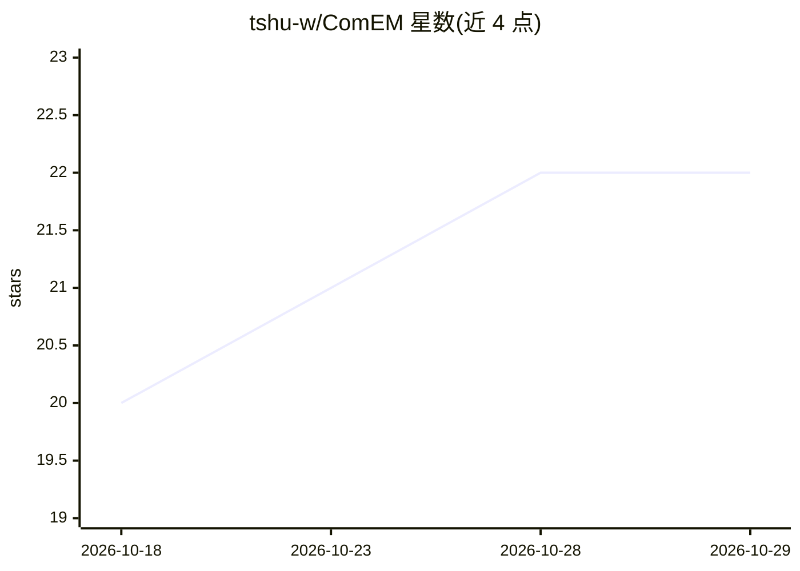

# tshu-w/ComEM

⭐ 22 · Python · 推送 2026-05-27 · [GitHub](https://github.com/tshu-w/ComEM) · 个人维护

**COLING 2025 论文代码：LLM 实体匹配的三种策略与复合框架**

论文 'Match, Compare, or Select? An Investigation of Large Language Models for Entity Matching'（COLING 2025）的配套代码。研究 LLM 实体匹配中匹配、比较、选择三种策略，并设计复合实体匹配框架 ComEM，组合多种策略与多个 LLM；在 8 个 ER 数据集、9 个 LLM 上进行实验。使用方式为 git clone 后安装依赖并准备数据，运行 python src/{strategy}.py 复现论文主要结果。

## 筛选速览

| 维度 | 判定 | 备注 |
|---|---|---|
| AI 角色 | `ai-native` | 本体是模型或模型工具 |
| 许可风险 | `none` | — |
| 部署形态 | `None` |  |
| 模型依赖 | — | README 未给出锁定关系 |
| 硬件要求 | — | 无带数字的原话,不猜 |
| 安装摩擦 | `low` | 无编译、无系统依赖或容器化 |
| 成熟度 | — | 结构信号不足 |

## 能力要点

- 对比 matching/comparing/selecting 三种 LLM 实体匹配策略
- 复合框架 ComEM 组合多策略与多 LLM
- 在 8 个 ER 数据集和 9 个 LLM 上实验

## 适用场景

- 复现论文的实体匹配实验结果
- 研究 LLM 在数据集成/实体消解中的应用方式
- 比较不同 LLM 匹配策略的成本与效果

## 场景标签

`科研工具` · 领域:学习与行业

## 证据(README 行号)

> L15: Entity matching (EM) is a critical step in entity resolution (ER). Recently, entity matching based on large languag
> L28: python src/{strategy}.py

## 星数曲线

2026-10-18 20 → 2026-10-29 22（+2）

---
*卡片 v1 · prompt 1.4 · 生成 2026-10-28 · 置信度 high · 依据 README sha `44f6d6d63890` · [字段定义](../../DATASET.md)*
