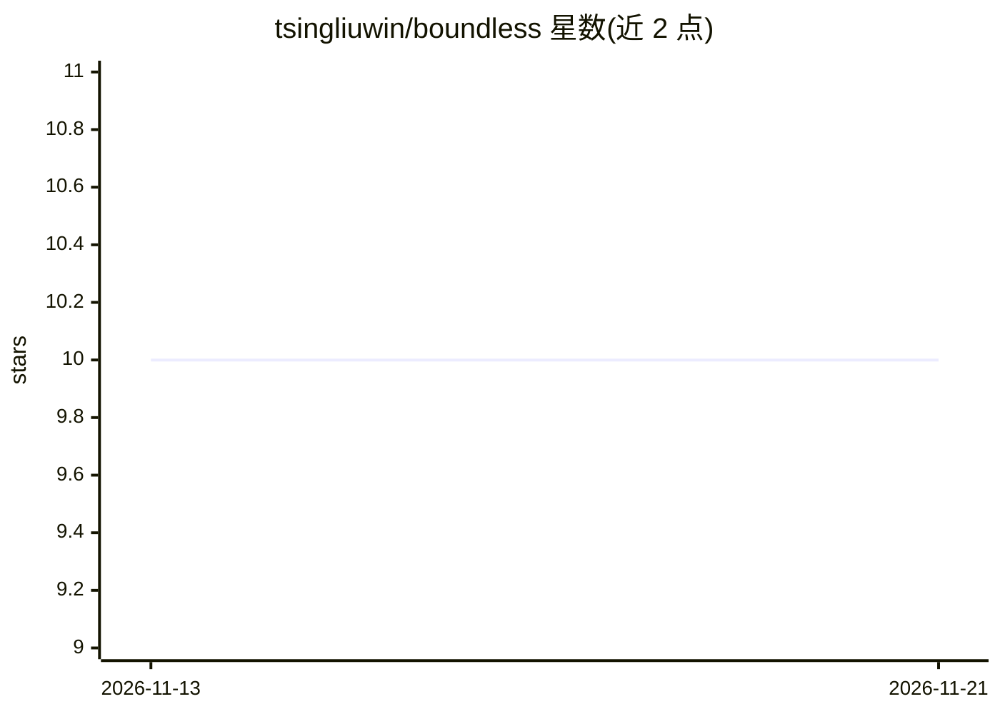

# tsingliuwin/boundless

⭐ 10 · Rust · AGPL-3.0 · 推送 2026-11-13 · [GitHub](https://github.com/tsingliuwin/boundless) · [官网](https://github.com/tsingliuwin/boundless/releases) · 个人维护 · 中文 README

**给设计师与演示者的手绘风无限白板，AI 直接在画布作画**

用 Rust + GPUI 编写的无限白板桌面应用：画笔带压感、rough 风格手绘抖动线条、多种填充与画布表面预设、多页面与 PowerPoint 式全屏放映、撤销/重做与自动保存。内置 rig 驱动的 AI 智能体，通过多轮工具调用把元素直接画到画布上，提供 slides、comic、文章插画、黑板报、水墨山水、思维导图六种 SKILL.md 格式技能，技能文件放入用户目录即可扩展。AI 端点在应用内设置页配置，任意 OpenAI 兼容端点可用。提供 Windows/macOS 安装包，源码构建需 Rust nightly。

## 筛选速览

| 维度 | 判定 | 备注 |
|---|---|---|
| AI 角色 | `ai-enhanced` | 去掉 AI 部分产品仍成立 |
| 许可风险 | `viral` | AGPL-3.0 |
| 部署形态 | `desktop` | 安装包/桌面程序 |
| 模型依赖 | local-ok | 支持本地模型 |
| 硬件要求 | — | 无带数字的原话,不猜 |
| 安装摩擦 | `medium` | 含编译或系统依赖之一 |
| 成熟度 | — | 结构信号不足 |

## 能力要点

- AI 智能体通过工具调用直接在画布上生成元素，而非返回图片或代码
- 六种内置创作技能（slides/comic/插画/黑板报/水墨/思维导图），SKILL.md 文件即扩展
- 手绘渲染：压感画笔、rough 风格抖动、五种填充、宣纸/黑板等画布预设
- 多页面放映、自托管 latest.json 自动更新并带 minisign 签名校验

## 适用场景

- 手绘风格的演示文稿和课堂板书制作
- 画漫画分镜或给文章配解释性插画
- 让 AI 帮忙把一段描述直接画成思维导图
- 日常白板草图与头脑风暴

## 场景标签

`图像生成` · 领域:内容生成

## 证据(README 行号)

> L5: **An infinite hand-drawn whiteboard on GPUI — with an AI agent that draws directly onto the canvas.**
> L12: 无界白板（boundless）是一个用 Rust + GPUI 写的无限白板：笔迹带压感、图形自带手绘抖动（rough.js 风格）、多页面放映，内置一个 rig 驱动的 AI 智能体——你说"画一份讲递归的 PPT"，它就调用工
> L27: **AI 智能体**

## 星数曲线

2026-11-13 10 → 2026-11-21 10（+0）

---
*卡片 v1 · prompt 1.4 · 生成 2026-11-19 · 置信度 high · 依据 README sha `eee82c704749` · [字段定义](../../DATASET.md)*
