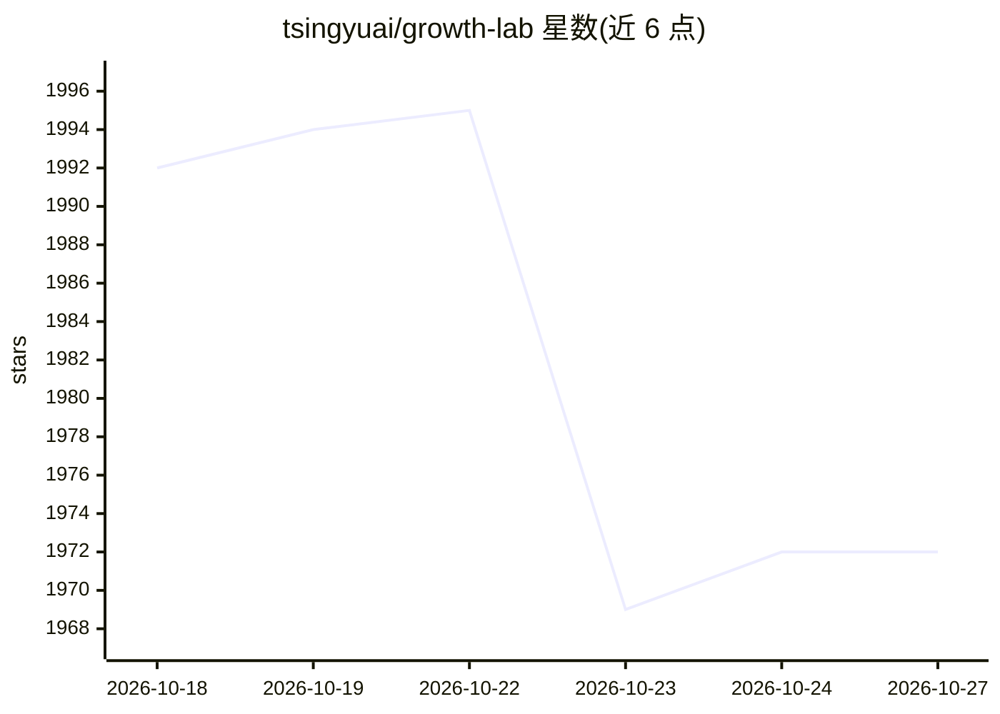

# tsingyuai/growth-lab

⭐ 1,972 · Python · Apache-2.0 · 推送 2026-09-28 · [GitHub](https://github.com/tsingyuai/growth-lab) · [官网](https://growthlab.tsingyuai.com) · 组织维护 · 中文 README

**以 Codex/Claude Code 为运行时的端到端产品增长工具**

通过自然语言驱动的增长工作流：以 Codex 或 Claude Code 作为应用 Runtime，用 Skill 定义增长方法、Client 接入浏览器与平台 API、文件系统作长期记忆。已实现 SEO 页面增长闭环、小红书内容采集创作与复盘、公众号长文草稿同步（默认只建草稿，自动发布需三重确认）。用户 git clone 后用 coding agent 打开目录即可使用；密钥、cookie 等保存在仓库外，不进入 Memory。

## 筛选速览

| 维度 | 判定 | 备注 |
|---|---|---|
| AI 角色 | `ai-native` | 本体是模型或模型工具 |
| 许可风险 | `permissive` | Apache-2.0 |
| 部署形态 | `None` |  |
| 模型依赖 | locked-api |  |
| 硬件要求 | — | 无带数字的原话,不猜 |
| 安装摩擦 | `low` | 无编译、无系统依赖或容器化 |
| 成熟度 | — | 结构信号不足 |

## 能力要点

- SEO 页面增长闭环：调研搜索场景并生成引流页面
- 小红书闭环：采集、创作、生图、卡片渲染、合规检查与发布复盘（发布保持人工边界）
- 公众号长文：预览合规检查后经官方 API 同步草稿，三重确认受控发布
- 开源且数据归用户：产品资料、Memory 与产物保存在用户工作区

## 适用场景

- 让 Agent 理解我的产品并跑通第一个增长闭环
- 自动化小红书内容选题、创作与效果复盘
- 批量生成针对真实搜索需求的 SEO 页面

## 场景标签

`工作流自动化` `AI 写作` `网页抓取` · 领域:效率与自动化

## 证据(README 行号)

> L25: 现代 Coding Agent 已经能够读取代码仓库、搜索网络、操作工具、编辑文件、跨上下文推理，并在会话中与人协作。Growth Lab 以 Codex 和 Claude Code 作为应用 Runtime，将这些能力组织成端到
> L49: Growth Lab 的设计目标是覆盖全部增长渠道，从理解机会、选择行动，到执行、度量和决定下一步。目前已经支持 SEO 页面增长，以及小红书内容采集、爆款研究、创作、生图、卡片渲染、合规检查和发布结果复盘；并支持微信公众号长文创
> L51: ### 通过自然语言持续协作

## 星数曲线

2026-10-18 1,992 → 2026-10-27 1,972（-20）

---
*卡片 v1 · prompt 1.4 · 生成 2026-10-21 · 置信度 high · 依据 README sha `7e07b0eeabd5` · [字段定义](../../DATASET.md)*
