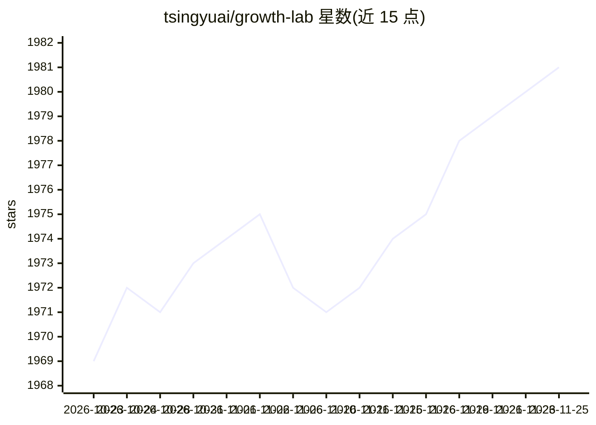

# tsingyuai/growth-lab

⭐ 1,981 · Python · Apache-2.0 · 推送 2026-11-13 · [GitHub](https://github.com/tsingyuai/growth-lab) · [官网](https://growthlab.tsingyuai.com) · 组织维护 · 中文 README

**开源增长运营工具：用自然语言运行增长闭环并自我复盘**

以 Codex 或 Claude Code 作为 Runtime 的增长工作流工具：将增长方法封装为 Skill，通过 Collector 采集需求、竞品与内容数据，通过 Executor 完成创作、发布与复盘；每个 Model 是“观察—行动—复盘”闭环并持有持久化 Memory，文件系统作为长期记忆。已实现 SEO 页面增长、小红书爆款复刻与公众号长文三个闭环。安装方式为 git clone 仓库后用 Coding Agent 打开，配置通过统一的 onboarding Skill 以自然语言完成；小红书发布保留人工边界，公众号默认只创建草稿。

## 筛选速览

| 维度 | 判定 | 备注 |
|---|---|---|
| AI 角色 | `ai-native` | 本体是模型或模型工具 |
| 许可风险 | `permissive` | Apache-2.0 |
| 部署形态 | `None` |  |
| 模型依赖 | — | README 未给出锁定关系 |
| 硬件要求 | — | 无带数字的原话,不猜 |
| 安装摩擦 | `low` | 无编译、无系统依赖或容器化 |
| 成熟度 | — | 结构信号不足 |

## 能力要点

- 以 Codex/Claude Code 为 Runtime，Skill 定义增长方法与工作流
- 每个 Model 为“观察—行动—复盘”闭环，带独立持久化 Memory
- 支持 SEO 页面生成、小红书采集/创作/合规检查、知乎官方 CLI 采集、公众号草稿同步
- 产品数据与 Memory 保存于用户本地工作区，仓库不分发私有数据

## 适用场景

- 为产品生成并复盘 SEO 页面增长策略
- 采集并研究小红书爆款内容，辅助创作与合规检查
- 通过知乎官方接口采集搜索、热榜与回答摘要做市场研究

## 场景标签

`工作流自动化` `AI 写作` · 领域:效率与自动化

## 证据(README 行号)

> L25: 现代 Coding Agent 已经能够读取代码仓库、搜索网络、操作工具、编辑文件、跨上下文推理，并在会话中与人协作。Growth Lab 以 Codex 和 Claude Code 作为应用 Runtime，将这些能力组织成端到
> L49: Growth Lab 的设计目标是覆盖全部增长渠道，从理解机会、选择行动，到执行、度量和决定下一步。目前已经支持 SEO 页面增长，以及小红书内容采集、爆款研究、创作、生图、卡片渲染、合规检查和发布结果复盘；支持通过知乎官方 CL

## 星数曲线

2026-10-23 1,969 → 2026-11-25 1,981（+12）

---
*卡片 v1 · prompt 1.4 · 生成 2026-11-23 · 置信度 mid · 依据 README sha `0b4932ee6449` · [字段定义](../../DATASET.md)*
