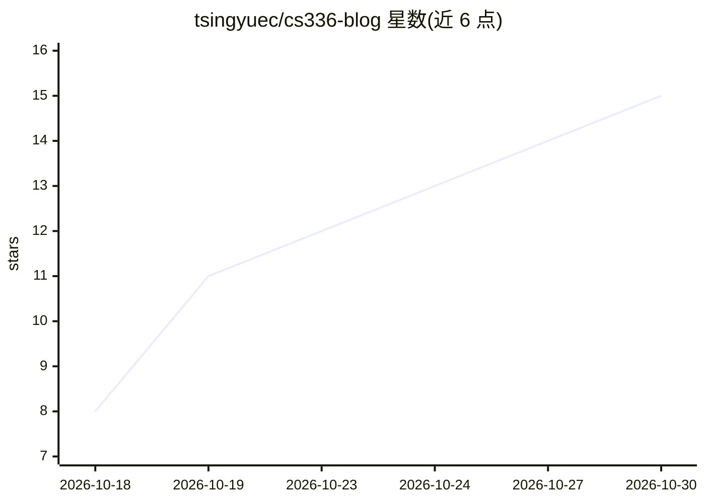

# tsingyuec/cs336-blog

⭐ 15 · 推送 2026-10-01 · [GitHub](https://github.com/tsingyuec/cs336-blog) · 个人维护 · 中文 README

**Stanford CS336 课程的中译视频整理成 18 篇中文技术博客与文稿**

将 B 站发布的 Stanford CS336《Language Modeling from Scratch》2026 中配版视频，逐秒抽帧并抓取 AI 字幕，先做成「图-字幕」原始文稿，再整理为 18 篇中文技术博客，覆盖分词、架构、并行、缩放律、推理、评测、数据、后训练与多模态对齐等主题，另含 1 篇重复分 P 的原始文稿。整理流程使用开源技能 video2blog-skill 完成。仓库声明仅用于个人学习与笔记整理，配图版权归原视频/课程作者。

## 筛选速览

| 维度 | 判定 | 备注 |
|---|---|---|
| AI 角色 | `ai-knowledge` | 知识聚合/清单类 |
| 许可风险 | `none` | — |
| 部署形态 | `None` |  |
| 模型依赖 | — | README 未给出锁定关系 |
| 硬件要求 | — | 无带数字的原话,不猜 |
| 安装摩擦 | `low` | 无编译、无系统依赖或容器化 |
| 成熟度 | — | 结构信号不足 |

## 能力要点

- 18 篇中文技术博客对应课程 18 讲，附 19 篇「图-字幕」原始文稿
- 由视频逐秒抽帧与 B 站 AI 字幕生成可核查文稿，再写成金字塔式博客
- 整理流程采用开源技能 video2blog-skill 完成
- 提供全课合并稿 blog/CS336_全课博客合集.md

## 适用场景

- 系统学习 CS336 从头构建大语言模型课程内容
- 按讲次查阅原始「图-字幕」文稿核对知识点出处
- 作为 LLM 训练相关主题（架构/并行/缩放律/后训练）的中文索引资料

## 场景标签

`教程课程` · 领域:学习与行业

## 证据(README 行号)

> L9: Stanford CS336《Language Modeling from Scratch（从头构建大语言模型）》2026 中配版的图文整理。
> L10: 本仓库把每个分 P 的视频逐秒抽帧、抓取 B 站 AI 字幕，先做成可核查的「图-字幕」原始文稿，
> L13: 本仓库的整理流程采用开源技能 **video2blog-skill** 完成（把 B 站 / YouTube 视频自动整理成中文技术博客），欢迎使用与关注。

## 星数曲线

2026-10-18 8 → 2026-10-30 15（+7）

---
*卡片 v1 · prompt 1.4 · 生成 2026-10-30 · 置信度 high · 依据 README sha `569cdb7af029` · [字段定义](../../DATASET.md)*
