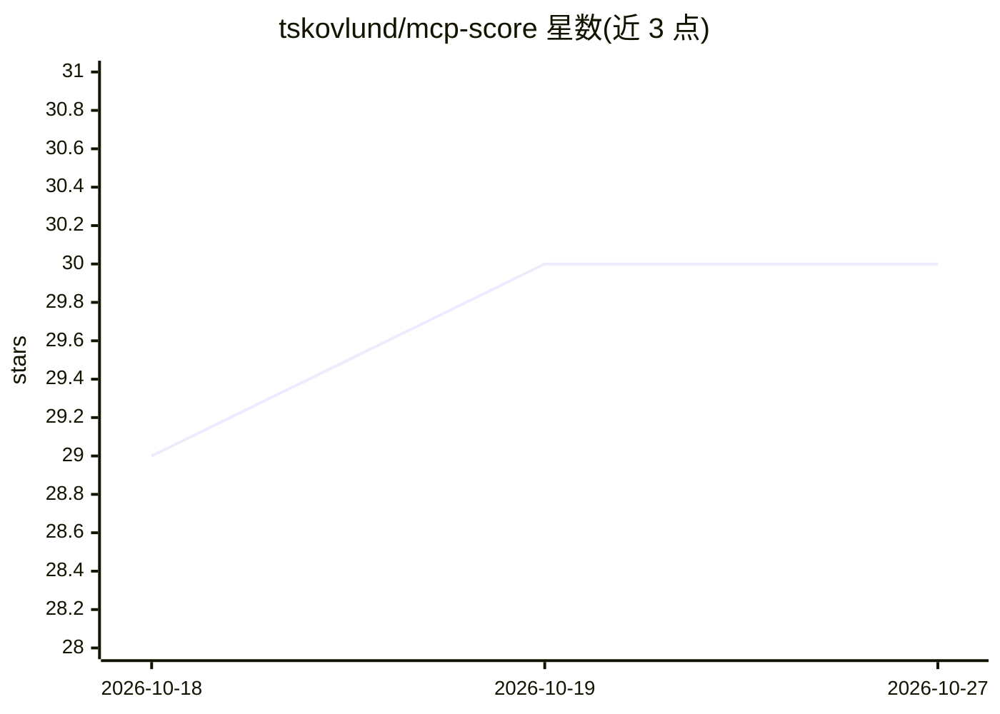

# tskovlund/mcp-score

⭐ 30 · Python · MIT · 推送 2026-10-26 · [GitHub](https://github.com/tskovlund/mcp-score) · 个人维护

**让 AI 助手生成与编辑乐谱的 MCP server（MusicXML+MuseScore）**

面向 MCP 客户端（Claude Code、Claude Desktop、LM Studio 等）的 MCP server，提供三类工具：生成乐谱（助手编写 music21 脚本导出 MusicXML，可在 MuseScore、Dorico 等打谱软件打开）、通过插件连接运行中的 MuseScore 实时读取与编辑乐谱（加音符、力度、和弦、移调等），以及经 MuseScore 命令行导出 PDF/PNG/MIDI/音频。需 Python 3.14+，MuseScore 4.4.2+ 支持实时编辑，Dorico 为实验性。自述状态为 alpha。

## 筛选速览

| 维度 | 判定 | 备注 |
|---|---|---|
| AI 角色 | `ai-ecosystem` | LLM/agent 周边工具 |
| 许可风险 | `permissive` | MIT |
| 部署形态 | `library` | 以包/库形式分发 |
| 模型依赖 | — | README 未给出锁定关系 |
| 硬件要求 | — | 无带数字的原话,不猜 |
| 安装摩擦 | `low` | 无编译、无系统依赖或容器化 |
| 成熟度 | `idea` | |

## 能力要点

- 自然语言描述生成 music21 脚本并导出 MusicXML
- 经插件连接运行中的 MuseScore 实时读写乐谱
- render_score 导出 PDF/PNG/MIDI/音频
- 提供 Claude Code 专用 score-generate 技能

## 适用场景

- 用对话让 AI 助手写出完整编谱并导出 MusicXML
- 在 MuseScore 中通过对话读取旋律并改编配器
- 批量把乐谱导出为 PDF、MIDI 或音频

## 场景标签

 · 领域:音乐/打谱工具

## 证据(README 行号)

> L9: Music notation for AI assistants. Describe a piece in plain language and get a MusicXML score; with MuseScore open, 
> L11: Works with any MCP client (Claude Code, Claude Desktop, LM Studio, and others). Status: alpha.
> L27: - **Generate scores.** The assistant writes a music21 script that exports MusicXML, which opens in MuseScore, Doric

## 星数曲线

2026-10-18 29 → 2026-10-27 30（+1）

---
*卡片 v1 · prompt 1.4 · 生成 2026-10-26 · 置信度 high · 依据 README sha `c03f63ab53dd` · [字段定义](../../DATASET.md)*
