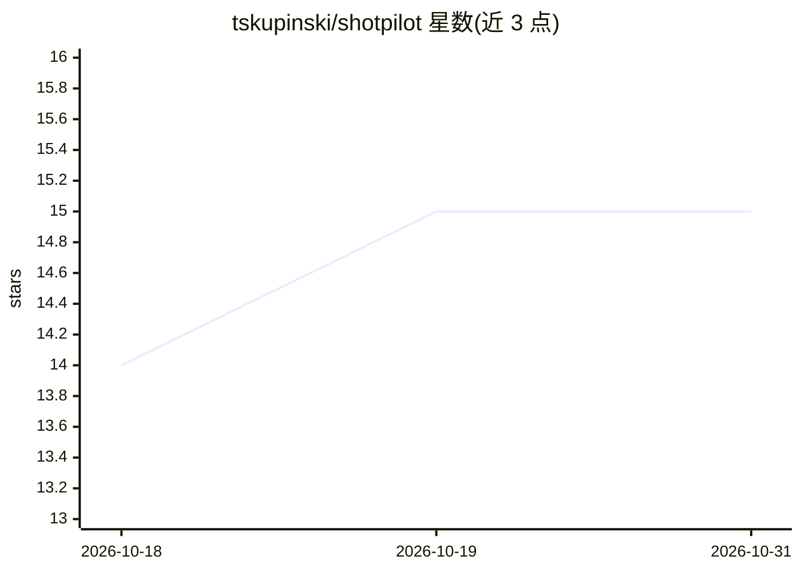

# tskupinski/shotpilot

⭐ 15 · Python · MIT · 推送 2026-07-28 · [GitHub](https://github.com/tskupinski/shotpilot) · [官网](https://shotpilot.video) · 个人维护

**无人机航拍素材自动剪辑成片的命令行流水线**

以 AI 编程 agent（Claude Code、Codex CLI 等）为主要操作者的视频后期流水线：用 OpenCV 做镜头运动平滑度分析（特征跟踪→光流→仿射变换），据此选片、计算节奏、切段拼接为带交叉淡出的蒙太奇（ffmpeg），支持调色、AI 生成配乐（Stable Audio，需付费 API key）及 YouTube 发布素材生成；提供 ./shot CLI（含 --json）与只读本地 Web UI 供人工使用。本体不含内置模型，无 agent 时是普通命令行工具；需 Python≥3.10、ffmpeg/ffprobe，macOS/Linux 限定，项目自述处于早期、资源占用高（4K 重编码约 4× 实时，--smooth 每片段约需 6 GB RAM）。

## 筛选速览

| 维度 | 判定 | 备注 |
|---|---|---|
| AI 角色 | `ai-enhanced` | 去掉 AI 部分产品仍成立 |
| 许可风险 | `permissive` | MIT |
| 部署形态 | `library` | 以包/库形式分发 |
| 模型依赖 | locked-api |  |
| 硬件要求 | — | 无带数字的原话,不猜 |
| 安装摩擦 | `medium` | 含编译或系统依赖之一 |
| 成熟度 | `idea` | |

## 能力要点

- OpenCV 运动分析（特征跟踪→光流→仿射）输出平滑度与节奏评分
- 选片、切段、交叉淡出蒙太奇、调色、配乐、发布素材全流程 CLI（./shot）
- 面向 agent 的技能（shot-review/pace-review/montage/autopilot）与决策规则文档
- 只读本地 Web UI 展示选片库、剪辑序列与决策记录

## 适用场景

- 把整卡无人机素材交给 AI agent 审片、选片并剪成成片
- 人工用 CLI 逐条执行运动分析、节奏评估与蒙太奇渲染
- 为航拍视频生成 YouTube 缩略图、标题与描述

## 场景标签

`图像视频处理` · 领域:感知与多模态

## 证据(README 行号)

> L10: > **Bring your own agent and LLM.** Shotpilot is not a standalone app and has
> L28: also works by hand — the CLI is a normal command-line tool with `--json` output.
> L3: Agent-first pipeline from drone footage to an edited film. It analyzes camera-motion

## 星数曲线

2026-10-18 14 → 2026-10-31 15（+1）

---
*卡片 v1 · prompt 1.4 · 生成 2026-10-30 · 置信度 high · 依据 README sha `e508493e12b8` · [字段定义](../../DATASET.md)*
