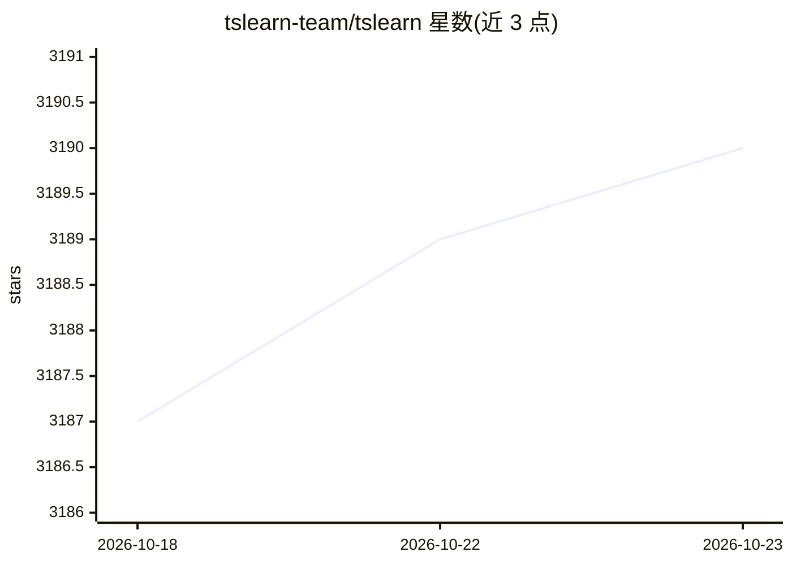

# tslearn-team/tslearn

⭐ 3,190 · Python · BSD-2-Clause · 推送 2026-10-22 · [GitHub](https://github.com/tslearn-team/tslearn) · [官网](https://tslearn.readthedocs.io) · 组织维护

**Python 时间序列机器学习工具包**

面向 Python 开发者与科研用户的时间序列机器学习库，提供分类、聚类、回归、早期分类等模型以及 DTW 等距离度量、预处理与数据转换工具。模型遵循 scikit-learn API 并与其工具（超参调优、pipeline）兼容；数据以 3D numpy 数组表示，支持变长时间序列，可加载 UCR 数据集或生成合成数据。要求 Python 3.10+，通过 PyPI、Conda 或 Git 安装。附有 JMLR 论文供学术引用。

## 筛选速览

| 维度 | 判定 | 备注 |
|---|---|---|
| AI 角色 | `ai-native` | 本体是模型或模型工具 |
| 许可风险 | `permissive` | BSD-2-Clause |
| 部署形态 | `library` | 以包/库形式分发 |
| 模型依赖 | — | README 未给出锁定关系 |
| 硬件要求 | — | 无带数字的原话,不猜 |
| 安装摩擦 | `low` | 无编译、无系统依赖或容器化 |
| 成熟度 | — | 结构信号不足 |

## 能力要点

- 遵循 scikit-learn API，兼容其超参调优与 pipeline 工具
- 覆盖 TimeSeriesKMeans/KShape/LearningShapelets/早期分类等模型
- 提供 DTW、全局对齐核、Matrix Profile 等度量与 barycenter 计算
- 支持变长时间序列、UCR 数据集加载与合成数据生成

## 适用场景

- 对时间序列做分类、聚类或回归建模
- 用 DTW 等度量计算时间序列间距离
- 在 scikit-learn 工作流中处理时间序列数据

## 场景标签

 · 领域:机器学习/时间序列分析

## 证据(README 行号)

> L74: After getting the data in the right format, a model can be trained. Depending on the use case, tslearn supports dif
> L84: As can be seen, the models in tslearn follow the same API as those of the well-known scikit-learn. Moreover, they a

## 星数曲线

2026-10-18 3,187 → 2026-10-23 3,190（+3）

---
*卡片 v1 · prompt 1.4 · 生成 2026-10-20 · 置信度 high · 依据 README sha `efcd6b464ba1` · [字段定义](../../DATASET.md)*
