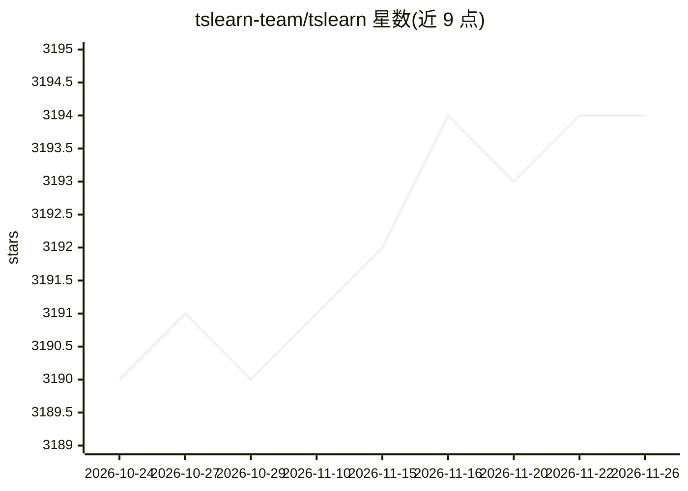

# tslearn-team/tslearn

⭐ 3,194 · Python · BSD-2-Clause · 推送 2026-11-23 · [GitHub](https://github.com/tslearn-team/tslearn) · [官网](https://tslearn.readthedocs.io) · 组织维护

**Python 时间序列机器学习工具库，覆盖分类/聚类/回归**

面向 Python 的时间序列机器学习工具库：数据需转换为 (n_ts, max_sz, d) 的 3D numpy 数组格式，支持变长时间序列，可从 UCR 数据集加载或用 generators 模块合成数据。提供预处理（缩放、分段变换）、聚类（TimeSeriesKMeans、KShape）、分类/回归（KNN、SVC/SVR、MLP、LearningShapelets）与距离度量（DTW、GAK、Matrix Profile）等模块。模型遵循 scikit-learn API 且与其完全兼容，可用超参调优与 pipeline。要求 Python 3.11+，经 PyPI/Conda/Git 安装。

## 筛选速览

| 维度 | 判定 | 备注 |
|---|---|---|
| AI 角色 | `ai-native` | 本体是模型或模型工具 |
| 许可风险 | `permissive` | BSD-2-Clause |
| 部署形态 | `library` | 以包/库形式分发 |
| 模型依赖 | — | README 未给出锁定关系 |
| 硬件要求 | — | 无带数字的原话,不猜 |
| 安装摩擦 | `low` | 无编译、无系统依赖或容器化 |
| 成熟度 | — | 结构信号不足 |

## 能力要点

- 支持变长时间序列与 3D numpy 数据格式转换
- 聚类/分类/回归模型遵循 scikit-learn API 并与其兼容
- 内置 DTW、GAK、Barycenters、Matrix Profile 等距离度量
- 支持加载 UCR 数据集与合成数据生成

## 适用场景

- 对时间序列做分类或聚类建模
- 用 DTW 等度量计算时间序列间距离
- 加载 UCR 基准数据集做实验
- 在 scikit-learn pipeline 中接入时间序列模型

## 场景标签

 · 领域:机器学习/时间序列分析

## 证据(README 行号)

> L74: After getting the data in the right format, a model can be trained. Depending on the use case, tslearn supports dif
> L84: As can be seen, the models in tslearn follow the same API as those of the well-known scikit-learn. Moreover, they a
> L92: |data|processing|clustering|classification|regression|metrics|

## 星数曲线

2026-10-24 3,190 → 2026-11-26 3,194（+4）

---
*卡片 v1 · prompt 1.4 · 生成 2026-11-23 · 置信度 high · 依据 README sha `dc33d111d0b7` · [字段定义](../../DATASET.md)*
