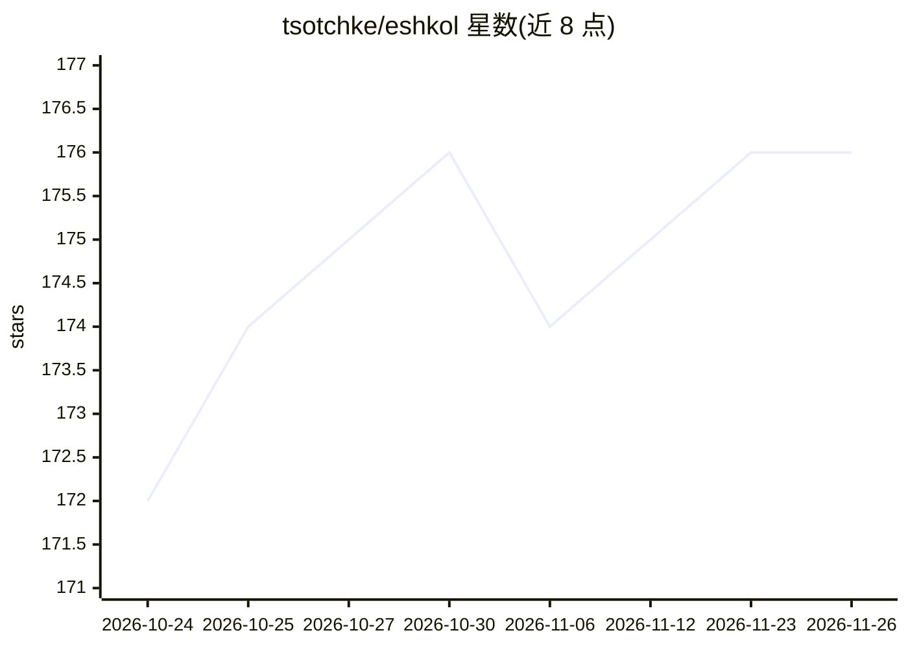

# tsotchke/eshkol

⭐ 176 · C++ · MIT · 推送 2026-11-25 · [GitHub](https://github.com/tsotchke/eshkol) · [官网](https://eshkol.ai) · 个人维护

**给科研与 AI 开发者的带原生自动微分的类 Scheme 语言**

Eshkol 是一门基于 Scheme 的数学计算编程语言，将自动微分作为语言原语内建于编译器，提供符号、前向与反向三种 AD 模式及任意阶泰勒展开引擎；用 C17/C++20 实现，经 LLVM 编译为本地代码，也可编译到 WebAssembly 在浏览器运行。内存采用 arena 区域管理而非垃圾回收，类型系统基于同伦类型论。定位面向基于梯度的优化、数值模拟与机器学习场景，提供 JIT REPL 与标准库。

## 筛选速览

| 维度 | 判定 | 备注 |
|---|---|---|
| AI 角色 | `ai-ecosystem` | LLM/agent 周边工具 |
| 许可风险 | `permissive` | MIT |
| 部署形态 | `None` |  |
| 模型依赖 | — | README 未给出锁定关系 |
| 硬件要求 | — | 无带数字的原话,不猜 |
| 安装摩擦 | `high` | 编译与系统依赖俱全 |
| 成熟度 | — | 结构信号不足 |

## 能力要点

- 自动微分内建于语言语义：符号/前向/反向模式与任意阶泰勒塔引擎
- LLVM 后端生成原生代码，并可编译到 WebAssembly 在浏览器运行 REPL
- Arena 区域内存管理，无垃圾回收，O(1) 分配与确定性释放
- 基于 HoTT 的渐变类型系统，编译期检查维度正确性与线性性

## 适用场景

- 训练线性模型等梯度优化任务时免去手写求导
- 在浏览器 Playground 中试验自动微分与 ODE 求解
- 开发需要确定性内存与实时性能的机器学习部署

## 场景标签

`科研工具` · 领域:学习与行业

## 证据(README 行号)

> L5: Eshkol is a Scheme-based programming language that unifies functional programming with native automatic differentiat
> L114: Automatic differentiation is not a library feature—it is intrinsic to the language semantics. Eshkol provides thre

## 星数曲线

2026-10-24 172 → 2026-11-26 176（+4）

---
*卡片 v1 · prompt 1.4 · 生成 2026-11-26 · 置信度 mid · 依据 README sha `6bb6776f1612` · [字段定义](../../DATASET.md)*
