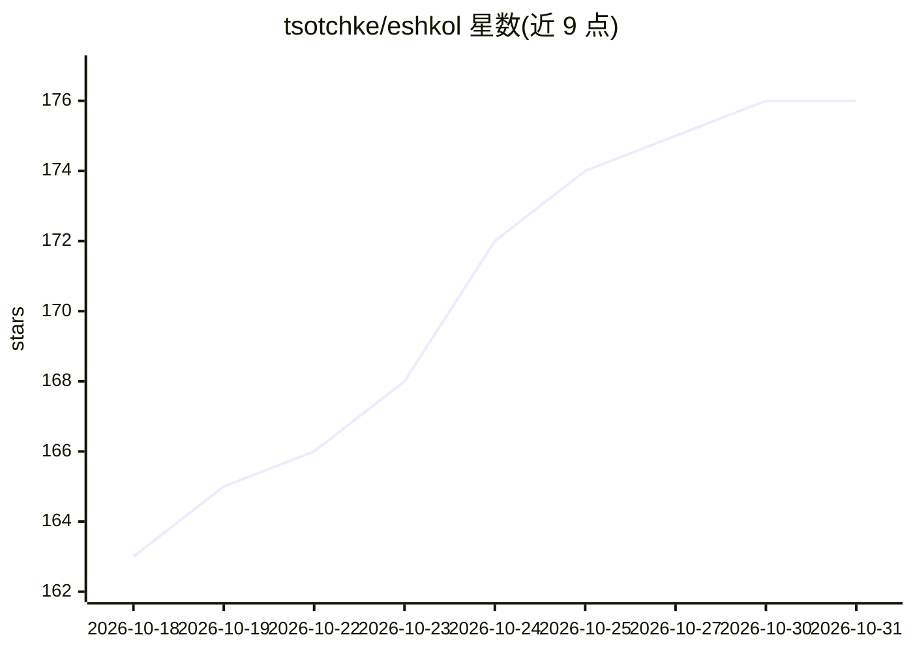

# tsotchke/eshkol

⭐ 176 · C++ · MIT · 推送 2026-10-30 · [GitHub](https://github.com/tsotchke/eshkol) · [官网](https://eshkol.ai) · 个人维护

**带原生自动微分的 Scheme 方言，面向科学计算与机器学习**

用 C17/C++20 实现的 Scheme 系编程语言，将自动微分（符号、前向、反向模式及任意阶 Taylor）作为编译器原语，支持向量 calculus 算子，经 LLVM 编译为本地代码，并可编译到 WebAssembly。内存采用 arena 分配，无垃圾回收器，提供确定性内存管理。面向需要梯度优化、数值仿真与机器学习开发的用户；README 同时注明类型检查器目前不 discharged 证明义务。安装需从源码构建（CMake 3.14+、LLVM、C17/C++20 编译器），另有浏览器 Playground 供在线试用。

## 筛选速览

| 维度 | 判定 | 备注 |
|---|---|---|
| AI 角色 | `ai-ecosystem` | LLM/agent 周边工具 |
| 许可风险 | `permissive` | MIT |
| 部署形态 | `None` |  |
| 模型依赖 | — | README 未给出锁定关系 |
| 硬件要求 | — | 无带数字的原话,不猜 |
| 安装摩擦 | `high` | 编译与系统依赖俱全 |
| 成熟度 | — | 结构信号不足 |

## 能力要点

- 自动微分为语言原语：符号/前向/反向模式与任意阶 Taylor 展开
- LLVM 后端生成本地代码，并可编译到 WebAssembly（含浏览器内 AD）
- Arena 分配、O(1) 分配、无垃圾回收的确定性内存模型
- 提供 JIT REPL 与 eshkol-run 运行/编译命令

## 适用场景

- 在 Lisp 语法下编写带自动微分的梯度优化与机器学习程序
- 数值仿真与 ODE 求解等科学计算任务
- 在浏览器 Playground 中无需安装试用语言与 AD 功能

## 场景标签

 · 领域:科学计算/编程语言

## 证据(README 行号)

> L5: Eshkol is a Scheme-based programming language that unifies functional programming with native automatic differentiat
> L32: - **True automatic differentiation** - Not numerical approximation. Exact symbolic, forward-mode, and reverse-mode 

## 星数曲线

2026-10-18 163 → 2026-10-31 176（+13）

---
*卡片 v1 · prompt 1.4 · 生成 2026-10-22 · 置信度 high · 依据 README sha `c07a6932c49d` · [字段定义](../../DATASET.md)*
