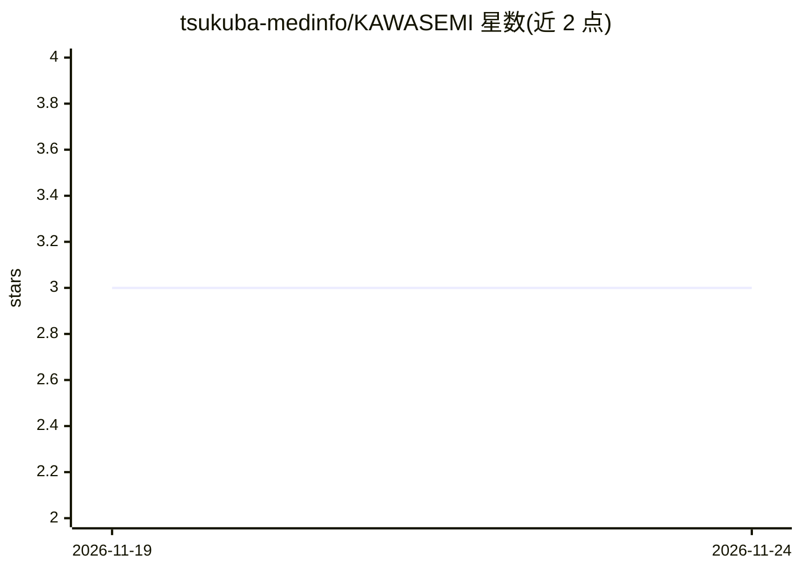

# tsukuba-medinfo/KAWASEMI

⭐ 3 · Python · Apache-2.0 · 推送 2026-11-19 · [GitHub](https://github.com/tsukuba-medinfo/KAWASEMI) · 组织维护

**辅助医院数据转录为病例登记表单的研究软件**

KAWASEMI 支持将医院系统数据填入病例登记表单（FHIR Questionnaire/QuestionnaireResponse），以 JASPEHR Implementation Guide 为目标。除手动输入外，AI 模式用本地 LLM（Ollama 或 vLLM）辅助设计每项数据的获取方式：临床含义、数据所在位置、自然语言获取步骤，以及编译为可执行 DSL。人在确认后对数据库、文件、FHIR 服务器、CSV 执行，保留证据（文档、SQL、提示词）。设计为在机构网络内运行，LLM 本地执行。声明为研究软件、非医疗器械。通过 uv 安装，Web 应用基于 FastAPI。

## 筛选速览

| 维度 | 判定 | 备注 |
|---|---|---|
| AI 角色 | `ai-native` | 本体是模型或模型工具 |
| 许可风险 | `permissive` | Apache-2.0 |
| 部署形态 | `None` |  |
| 模型依赖 | local-ok | 支持本地模型 |
| 硬件要求 | — | 无带数字的原话,不猜 |
| 安装摩擦 | `low` | 无编译、无系统依赖或容器化 |
| 成熟度 | `idea` | |

## 能力要点

- AI 模式用本地 LLM 辅助设计数据获取方式并生成可执行 DSL
- 人工确认为前提，执行值保留文档、SQL、提示词等证据
- 面向 JASPEHR Implementation Guide，产出 FHIR Questionnaire/QuestionnaireResponse
- 全部处理在机构网络内完成，LLM 本地运行

## 适用场景

- 医院将院内系统数据转录为病例登记表单
- 在机构内网环境中用本地 LLM 自动化数据收集流程
- 以虚构数据演示登记填写的端到端流程

## 场景标签

`科研工具` · 领域:学习与行业

## 证据(README 行号)

> L13: 様式は手入力もできます。**データ自動収集（AI モード）** では、各項目の取得方法の設計をローカル LLM
> L14: （Ollama または vLLM）が支援します。設計する内容は次の 4 つです。
> L22: AI が書くのは下書きで、確定するのは人です。実行した値には、根拠（読んだ文書、SQL、LLM のプロンプト）が残ります。

## 星数曲线

2026-11-19 3 → 2026-11-24 3（+0）

---
*卡片 v1 · prompt 1.4 · 生成 2026-11-22 · 置信度 high · 依据 README sha `d57e668c186d` · [字段定义](../../DATASET.md)*
