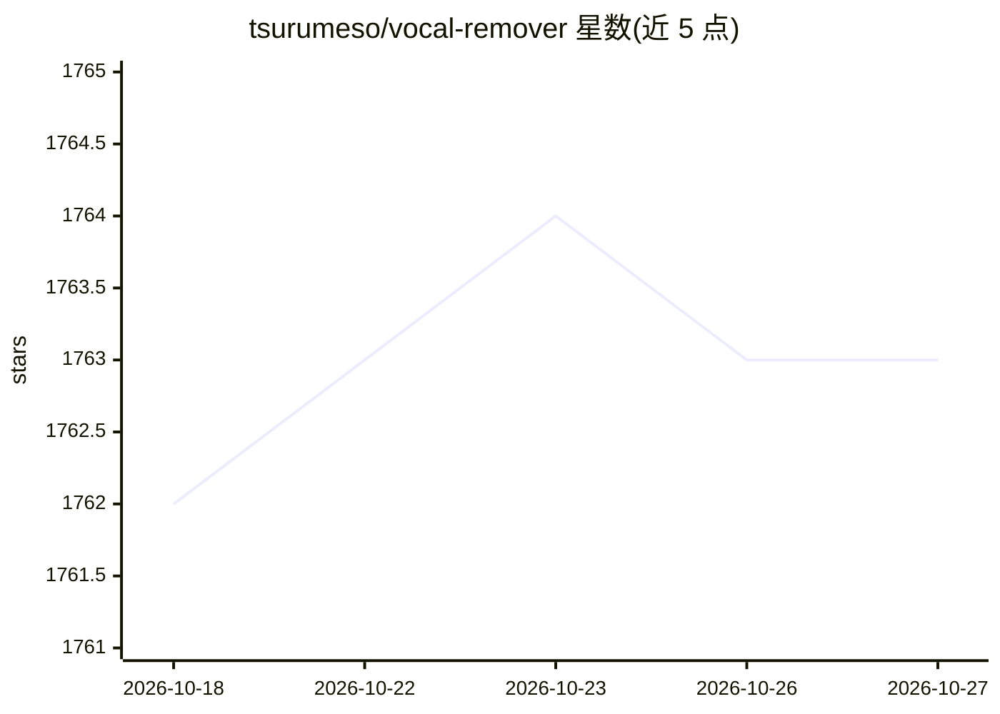

# tsurumeso/vocal-remover

⭐ 1,763 · Python · MIT · 推送 2026-09-10 · [GitHub](https://github.com/tsurumeso/vocal-remover) · 个人维护

**深度学习人声分离工具：从歌曲中提取伴奏**

基于深度神经网络（U-Net 结构，参考 Jansson 等人研究）的音频源分离工具：读取输入音频，用训练好的模型将其分离为伴奏与人声两条音轨，输出 *_Instruments.wav 与 *_Vocals.wav。支持 CPU 与 GPU 运行，提供 --tta 测试时增强与 --postprocess 后处理（标注为实验性功能）选项提升分离质量。另提供训练脚本，用户可用自己的数据集训练模型。需先安装 PyTorch 与 requirements.txt 中的依赖后从源码运行。

## 筛选速览

| 维度 | 判定 | 备注 |
|---|---|---|
| AI 角色 | `ai-native` | 本体是模型或模型工具 |
| 许可风险 | `permissive` | MIT |
| 部署形态 | `library` | 以包/库形式分发 |
| 模型依赖 | — | README 未给出锁定关系 |
| 硬件要求 | — | 无带数字的原话,不猜 |
| 安装摩擦 | `low` | 无编译、无系统依赖或容器化 |
| 成熟度 | — | 结构信号不足 |

## 能力要点

- 将歌曲分离为伴奏与人声两条音轨
- 支持 CPU 与 GPU 推理，提供 --tta 测试时增强选项
- 支持用自备数据集训练自己的模型
- --postprocess 基于人声音量掩码的后处理（实验性）

## 适用场景

- 从自己喜欢的歌曲中提取纯伴奏
- 提取人声干声用于翻唱或混音练习
- 用自己的音乐数据训练定制分离模型

## 场景标签

 · 领域:音频处理/音乐

## 证据(README 行号)

> L6: This is a deep-learning-based tool for extracting the instrumental track from your songs.
> L27: The following command separates the input into instrumental and vocal tracks. They are saved as `*_Instruments.wav`

## 星数曲线

2026-10-18 1,762 → 2026-10-27 1,763（+1）

---
*卡片 v1 · prompt 1.4 · 生成 2026-10-21 · 置信度 high · 依据 README sha `eecaef7dc9b3` · [字段定义](../../DATASET.md)*
