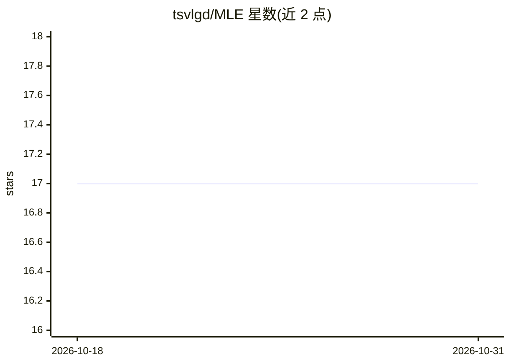

# tsvlgd/MLE

⭐ 17 · Jupyter Notebook · MIT · 推送 2026-02-22 · [GitHub](https://github.com/tsvlgd/MLE) · 个人维护

**从第一性原理学习机器学习的教程与实现代码库**

机器学习工程学习仓库，按“稳定内容/实验性内容/工具”组织：ml/ 目录收教程、算法实现与项目，advanced_ml/ 目录收神经网络与 PyTorch/OpenCV 实验笔记，tools/ 提供脚手架生成与 notebook 链接修复脚本。内容以 Jupyter notebook 形式交付，通过 git clone 获取后在 Jupyter 中运行，含 requirements.txt 声明依赖。

## 筛选速览

| 维度 | 判定 | 备注 |
|---|---|---|
| AI 角色 | `ai-knowledge` | 知识聚合/清单类 |
| 许可风险 | `permissive` | MIT |
| 部署形态 | `None` |  |
| 模型依赖 | — | README 未给出锁定关系 |
| 硬件要求 | — | 无带数字的原话,不猜 |
| 安装摩擦 | `low` | 无编译、无系统依赖或容器化 |
| 成熟度 | — | 结构信号不足 |

## 能力要点

- 分教程、实现、项目三层的 ml/ 稳定内容结构
- advanced_ml/ 收录神经网络与 PyTorch/OpenCV 实验内容
- 提供 scaffold_topics.py、fix_notebook_links.py 维护脚本

## 适用场景

- 按第一性原理路线系统学习机器学习算法
- 阅读并运行经典算法（如逻辑回归）的实现 notebook
- 参考神经网络与 PyTorch/OpenCV 的实验代码

## 场景标签

`教程课程` · 领域:学习与行业

## 证据(README 行号)

> L1: ### **MLE — Machine Learning Engineering from First Principles**
> L12:  - Tutorials: `ml/01-docs/`
> L13:  - Implementations: `ml/02-implementations/`

## 星数曲线

2026-10-18 17 → 2026-10-31 17（+0）

---
*卡片 v1 · prompt 1.4 · 生成 2026-10-29 · 置信度 mid · 依据 README sha `942ee8ea3e1e` · [字段定义](../../DATASET.md)*
