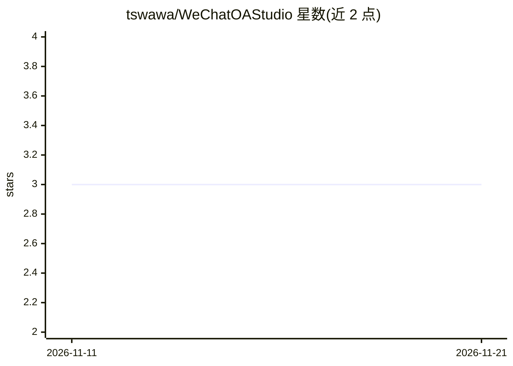

# tswawa/WeChatOAStudio

⭐ 3 · JavaScript · GPL-3.0 · 推送 2026-11-15 · [GitHub](https://github.com/tswawa/WeChatOAStudio) · 个人维护 · 中文 README

**面向公众号作者的 AI 自动采集写稿与发表工作台**

Electron + Vue 3 桌面应用，把资料采集、写稿、配图、排版和发表串成连续任务：Bot 按自然语言指令搜索网页、核对来源、生成标题摘要正文，从搜索结果取图并由多模态模型审核配图，套用文章模板后保存草稿或经微信页面/官方接口发表，支持定时任务、多账号管理、长期记忆与操作确认卡。提供 Windows x64 安装包与免安装包，需自行配置模型接口地址与 API Key，模型服务费用由所选服务商计费。

## 筛选速览

| 维度 | 判定 | 备注 |
|---|---|---|
| AI 角色 | `ai-native` | 本体是模型或模型工具 |
| 许可风险 | `viral` | GPL-3.0 |
| 部署形态 | `desktop` | 安装包/桌面程序 |
| 模型依赖 | — | README 未给出锁定关系 |
| 硬件要求 | — | 无带数字的原话,不猜 |
| 安装摩擦 | `low` | 无编译、无系统依赖或容器化 |
| 成熟度 | — | 结构信号不足 |

## 能力要点

- 联网搜集资料、写稿、配图、排版到草稿/发表的连续自动化流程
- 支持 OpenAI 兼容、Anthropic、Gemini 等多种 API 格式，配图需图像输入模型
- 定时任务与快捷任务，自动发表使用公众号官方接口
- 多公众号管理、草稿箱、留言互动与数据/收入查看

## 适用场景

- 交代主题和篇幅，让 AI 采集资料并生成图文文章
- 把每日行业简报等固定栏目设为定时任务自动执行
- 在同一工作台管理多个公众号的草稿、互动与数据

## 场景标签

`AI 写作` `网页抓取` `浏览器自动化` `工作流自动化` · 领域:效率与自动化

## 证据(README 行号)

> L3: AI 驱动的微信公众号内容自动化工作台。Bot 可以自行上网搜集资料、核对来源、撰写文稿、寻找配图、套用模板，并按作者授权自动保存和发送文章。
> L25: 在 Bot 中说明要写什么、写多少字、采用什么风格和是否发送，AI 按要求连续处理整篇文章。
> L197: |Chat Completions|OpenAI 及兼容接口|

## 星数曲线

2026-11-11 3 → 2026-11-21 3（+0）

---
*卡片 v1 · prompt 1.4 · 生成 2026-11-21 · 置信度 high · 依据 README sha `49d9ee3f52ad` · [字段定义](../../DATASET.md)*
