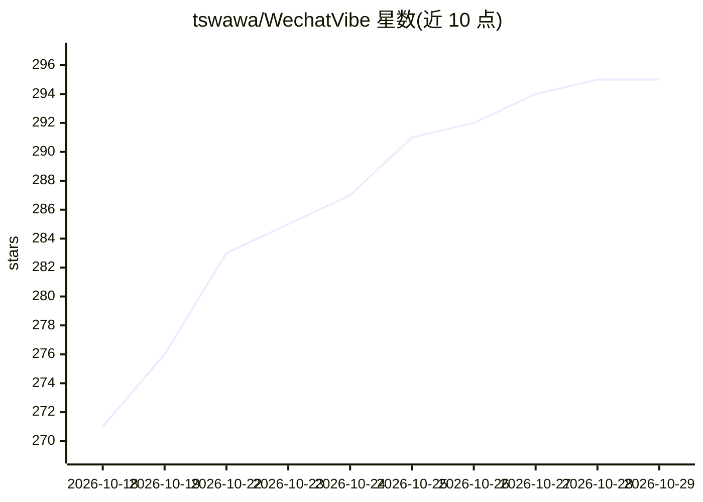

# tswawa/WechatVibe

⭐ 295 · Python · Apache-2.0 · 推送 2026-10-11 · [GitHub](https://github.com/tswawa/WechatVibe) · [官网](https://github.com/tswawa/WechatVibe/releases/latest) · 个人维护 · 中文 README

**Windows 微信聊天情感分析客户端：情绪意图识别与人物画像**

基于 Electron 的 Windows 桌面应用，只读读取本机已登录的 Windows 微信 4.x 聊天数据，在应用内分析消息情绪与意图，生成好感度、MBTI 推测、六维互动风格、人物/群聊画像，并附聊天助手提供交流建议与回复草稿。默认使用本地 Laya 多语言 ONNX 模型（约 3.22 亿参数，纯 CPU 可运行），也可接入 Anthropic、Gemini、Ollama 等兼容 API。仅支持 Windows 10/11 x64，不提供聊天记录导出。

## 筛选速览

| 维度 | 判定 | 备注 |
|---|---|---|
| AI 角色 | `ai-native` | 本体是模型或模型工具 |
| 许可风险 | `permissive` | Apache-2.0 |
| 部署形态 | `desktop` | 安装包/桌面程序 |
| 模型依赖 | local-ok | 支持本地模型 |
| 硬件要求 | — | 无带数字的原话,不猜 |
| 安装摩擦 | `low` | 无编译、无系统依赖或容器化 |
| 成熟度 | — | 结构信号不足 |

## 能力要点

- 本地 Laya ONNX 模型完成情绪/意图识别与画像分析，纯 CPU 可运行
- 支持接入 Anthropic、Responses、Chat Completions、Gemini 及 Ollama 兼容 API
- 好感度、MBTI 四维倾向、六维互动风格雷达图与群聊成员画像
- 聊天助手可从 GitHub/SKILL.md 导入助手与技能，回答不自动发送

## 适用场景

- 回看自己微信聊天中的情绪变化和交流方式
- 了解单聊对象或群聊成员的互动风格画像
- 结合当前会话让助手拟写回复草稿

## 场景标签

`数据分析` `AI 助手` · 领域:效率与自动化

## 证据(README 行号)

> L14: WechatVibe 只读读取本机已登录的 Windows 微信，分析聊天中的情绪和意图，并生成人物画像、好感度和 MBTI 推测。聊天助手可以结合当前会话提供交流建议和回复草稿。适合想回看聊天中的情绪变化、了解日常交流方式的用户
> L16: - **本地模型**：使用 Laya 多语言 ONNX 模型，在本机完成分析。

## 星数曲线

2026-10-18 271 → 2026-10-29 295（+24）

---
*卡片 v1 · prompt 1.4 · 生成 2026-10-22 · 置信度 mid · 依据 README sha `5ef21d68e1db` · [字段定义](../../DATASET.md)*
