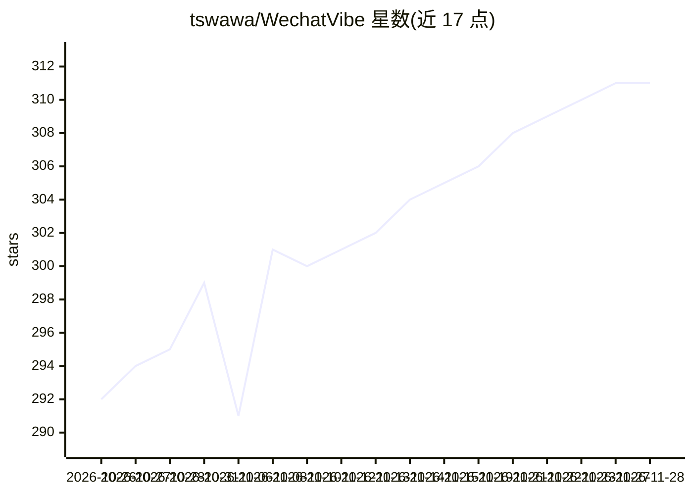

# tswawa/WechatVibe

⭐ 311 · Python · Apache-2.0 · 推送 2026-11-10 · [GitHub](https://github.com/tswawa/WechatVibe) · [官网](https://github.com/tswawa/WechatVibe/releases/latest) · 个人维护 · 中文 README

**给微信个人用户做本地聊天情绪与画像分析的桌面工具**

基于 Electron 的 Windows 桌面应用，只读读取本机已登录的微信 4.x 数据库，对单聊与群聊消息做情绪与意图标注，累积生成人物画像、好感度、MBTI 推测和群聊整体画像。默认用本地 Laya 多语言 ONNX 模型（约 3.22 亿参数，纯 CPU 可运行），也可接入 Anthropic、Gemini、Chat Completions、Responses 或 Ollama 兼容 API。聊天助手可结合当前会话生成交流建议与回复草稿，需模型支持工具调用；助手只读，不会自动发送消息。不含聊天记录导出功能。

## 筛选速览

| 维度 | 判定 | 备注 |
|---|---|---|
| AI 角色 | `ai-native` | 本体是模型或模型工具 |
| 许可风险 | `permissive` | Apache-2.0 |
| 部署形态 | `desktop` | 安装包/桌面程序 |
| 模型依赖 | local-ok | 支持本地模型 |
| 硬件要求 | — | 无带数字的原话,不猜 |
| 安装摩擦 | `low` | 无编译、无系统依赖或容器化 |
| 成熟度 | — | 结构信号不足 |

## 能力要点

- 本地 Laya ONNX 模型推理，纯 CPU 可运行，无需独立显卡
- 支持 Anthropic、Responses、Chat Completions、Gemini、Ollama 兼容接口接入
- 人物画像、好感度与 MBTI 结果按模型来源与会话增量续算保存
- 助手仓库支持从 GitHub 地址、SKILL.md 或 ZIP 导入聊天助手

## 适用场景

- 回看自己微信聊天中的情绪变化与交流方式
- 了解单聊对象和群成员的互动风格画像
- 用聊天助手结合当前会话获取交流建议和回复草稿

## 场景标签

`推理引擎` · 领域:训练与推理

## 证据(README 行号)

> L18: WechatVibe 只读读取本机已登录的 Windows 微信，分析聊天中的情绪和意图，并生成人物画像、好感度和 MBTI 推测。聊天助手可以结合当前会话提供交流建议和回复草稿。适合想回看聊天中的情绪变化、了解日常交流方式的用户
> L20: - **本地模型**：使用 Laya 多语言 ONNX 模型，在本机完成分析。

## 星数曲线

2026-10-26 292 → 2026-11-28 311（+19）

---
*卡片 v1 · prompt 1.4 · 生成 2026-11-25 · 置信度 mid · 依据 README sha `897c0a7c3454` · [字段定义](../../DATASET.md)*
