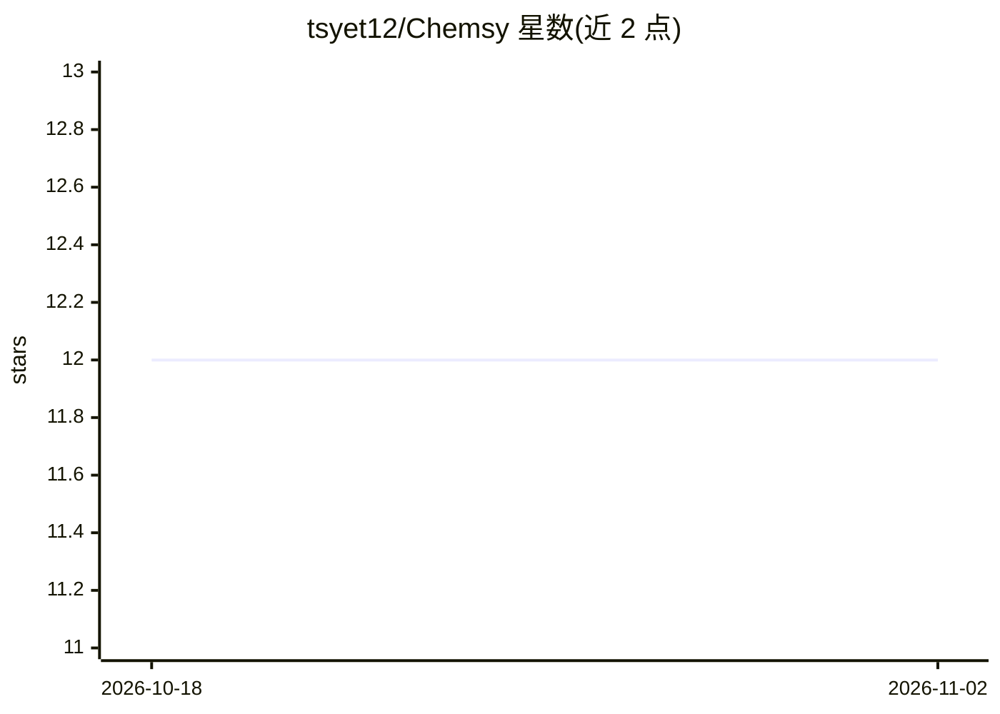

# tsyet12/Chemsy

⭐ 12 · Python · BSD-2-Clause · 推送 2026-03-26 · [GitHub](https://github.com/tsyet12/Chemsy) · 个人维护

**化学计量学自动预处理搜索框架：光谱与工业过程数据建模**

面向化学计量学与机器学习的轻量自动化框架，针对光谱数据和工业过程数据分析。核心机制是自动预处理搜索：用户定义 recipe 指定候选预处理方法组合，框架对全部组合进行评估，输出交叉验证 MAE/MSE/R2 等指标排序结果。语法遵循 sklearn，任何符合 sklearn 语法的算法可直接使用；内置 PLS 交叉验证、Savitzky–Golay 滤波、多种基线校正、散射校正等 21 种预处理方法和 14 种预测方法。支持回归与分类（classify 参数），以 pip 安装的 Python 库形式提供，附 Colab 教程。

## 筛选速览

| 维度 | 判定 | 备注 |
|---|---|---|
| AI 角色 | `ai-native` | 本体是模型或模型工具 |
| 许可风险 | `permissive` | BSD-2-Clause |
| 部署形态 | `library` | 以包/库形式分发 |
| 模型依赖 | — | README 未给出锁定关系 |
| 硬件要求 | — | 无带数字的原话,不猜 |
| 安装摩擦 | `low` | 无编译、无系统依赖或容器化 |
| 成熟度 | — | 结构信号不足 |

## 能力要点

- 基于 recipe 的自动预处理组合搜索，输出交叉验证指标对比
- 兼容 sklearn 语法的算法可直接使用
- 内置 21 种预处理方法（基线校正/散射校正/导数等）与 14 种预测方法
- 支持回归与分类，附 5 个 Colab 教程与自定义求解器扩展

## 适用场景

- 光谱数据建模前自动搜索最佳预处理组合
- 工业过程数据的回归与分类分析
- 复现文献（Engel 2013/Gerretzen 2015）中的预处理搜索方案

## 场景标签

`数据分析` · 领域:效率与自动化

## 证据(README 行号)

> L9: This project is to make a lightweight and flexible automatic framework for chemometrics and machine learning. The ma
> L36: Automatic pre-processing search with support for:

## 星数曲线

2026-10-18 12 → 2026-11-02 12（+0）

---
*卡片 v1 · prompt 1.4 · 生成 2026-10-31 · 置信度 high · 依据 README sha `e631c01436ff` · [字段定义](../../DATASET.md)*
