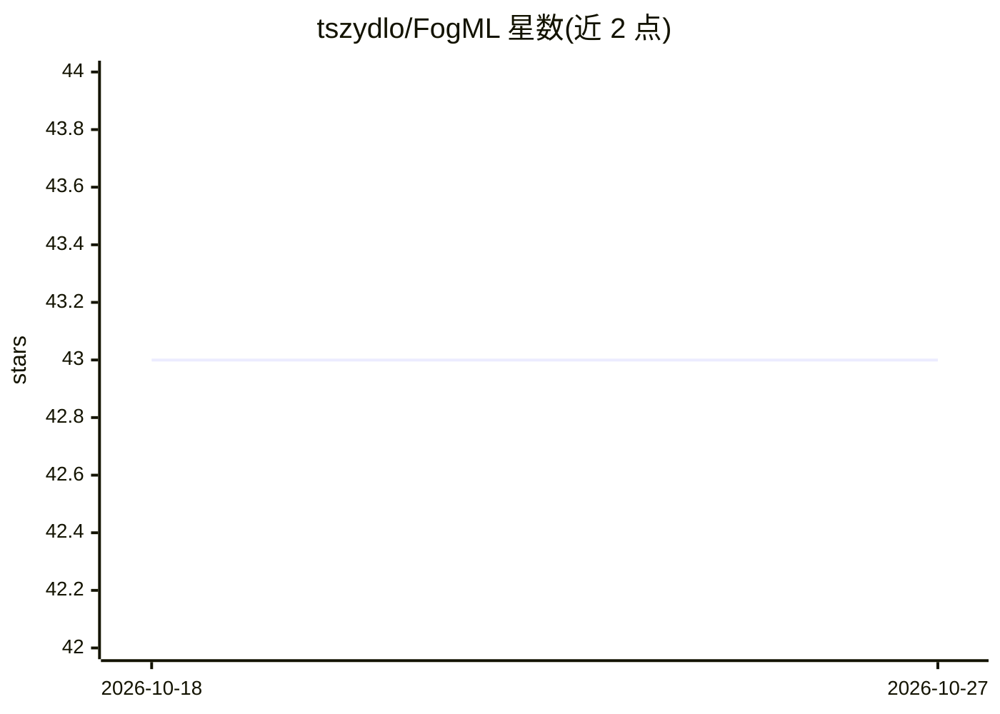

# tszydlo/FogML

⭐ 43 · Python · Apache-2.0 · 推送 2026-09-07 · [GitHub](https://github.com/tszydlo/FogML) · 个人维护

**把经典 ML 模型编译为微控制器 C 代码的 TinyML 工具链**

面向资源受限嵌入式设备（低至 ARM M0）的 TinyML 工具集：以 pip 包提供，读取 sklearn 训练的朴素贝叶斯、决策树/森林、MLP 等经典模型，生成可在设备上运行的推理 C 源码，减小内存占用。附带设备端时间序列特征计算（RMS、FFT 等）、基于蓄水池采样与 LOF 的在线异常检测、设备外分类训练与强化学习示例；另有关联仓库提供 Arduino、Zephyr、LwM2M/FOTA 等配套实现。

## 筛选速览

| 维度 | 判定 | 备注 |
|---|---|---|
| AI 角色 | `ai-ecosystem` | LLM/agent 周边工具 |
| 许可风险 | `permissive` | Apache-2.0 |
| 部署形态 | `library` | 以包/库形式分发 |
| 模型依赖 | — | README 未给出锁定关系 |
| 硬件要求 | — | 无带数字的原话,不猜 |
| 安装摩擦 | `low` | 无编译、无系统依赖或容器化 |
| 成熟度 | — | 结构信号不足 |

## 能力要点

- 从 sklearn 模型生成嵌入式推理 C 源码，支持朴素贝叶斯/决策树/MLP
- 设备端时间序列特征向量计算（RMS、FFT、幅度等）
- 基于蓄水池采样与 LOF 的设备端在线异常检测
- 面向 ARM M0 级微控制器，附 Arduino MNIST 与强化学习示例

## 适用场景

- 在微控制器上部署经典 ML 分类与异常检测模型
- IoT 设备做低内存占用的推理而不依赖深度神经网络
- 嵌入式开发中把 sklearn 训练成果转为可烧录的 C 代码

## 场景标签

`推理引擎` · 领域:训练与推理

## 证据(README 行号)

> L5: The FogML is a set of tools enabling TinyML on microcontrollers as low resource-limited as ARM M0 cores. In contrast
> L10: * the `src` folder contains the source code generators for machine learning models i.e.: naive bayes, decision tree
> L27: `pip install fogml`

## 星数曲线

2026-10-18 43 → 2026-10-27 43（+0）

---
*卡片 v1 · prompt 1.4 · 生成 2026-10-25 · 置信度 high · 依据 README sha `24b820400c7a` · [字段定义](../../DATASET.md)*
