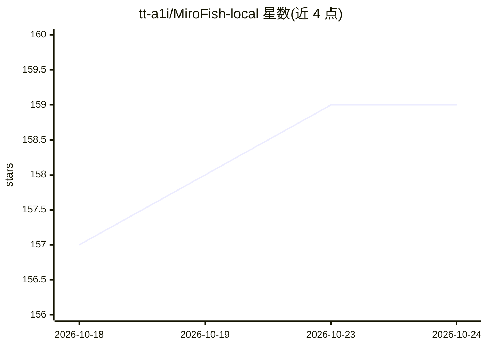

# tt-a1i/MiroFish-local

⭐ 159 · Python · AGPL-3.0 · 推送 2026-03-17 · [GitHub](https://github.com/tt-a1i/MiroFish-local) · 个人维护 · 中文 README

**MiroFish 的本地化 fork：Graphiti+Neo4j 替代 Zep Cloud 本地跑通**

基于 MiroFish 的修改版 fork，多智能体群体智能仿真引擎，用于模拟舆情、市场情绪与社会动态。流程为：种子材料经 GraphRAG 构建知识图谱、生成智能体人设、OASIS 引擎驱动并行模拟、ReportAgent 生成预测报告、支持与模拟角色对话。本 fork 新增 Graphiti+Neo4j 本地记忆后端，通过 ZEP_BACKEND 环境变量在 cloud/graphiti 双模式间切换，本地模式数据不出域；LLM 侧支持任何 OpenAI SDK 格式 API。需 Python 3.11+、Node.js 18+，Mac 下开发测试，Windows 兼容性未知。单次模拟 Token 消耗较大（建议首跑少于 40 轮，约 50-100 万 Token）。

## 筛选速览

| 维度 | 判定 | 备注 |
|---|---|---|
| AI 角色 | `ai-native` | 本体是模型或模型工具 |
| 许可风险 | `viral` | AGPL-3.0 |
| 部署形态 | `self-host` | docker 或自建部署 |
| 模型依赖 | local-ok | 支持本地模型 |
| 硬件要求 | `cpu-ok` | |
| 安装摩擦 | `low` | 无编译、无系统依赖或容器化 |
| 成熟度 | `idea` | |

## 能力要点

- Graphiti+Neo4j 本地记忆后端替代 Zep Cloud，数据不出域
- ZEP_BACKEND 环境变量一键切换 cloud/graphiti 双模式
- Docker Compose 一键启动 Neo4j 5.26 + APOC 插件
- 兼容 OpenAI SDK 格式的任意 LLM API（含本地 Ollama）

## 适用场景

- 在无外网或数据不出域要求下运行社会动态仿真
- 模拟突发事件舆情传播并生成预测报告
- 与仿真世界角色对话，探索不同决策路径的演化结果

## 场景标签

 · 领域:社会仿真/AI 预测

## 证据(README 行号)

> L18: MiroFish 是一款基于多智能体技术的 AI 预测引擎，通过构建高保真平行数字世界进行群体智能仿真。但原版 MiroFish 的记忆与知识图谱完全依赖 **Zep Cloud** 云服务——数据经过云端，且无法在离线环境运行。
> L62: |**图谱构建**|基于 GraphRAG 提取实体关系，注入个体与群体记忆，构建知识图谱。本地模式使用 Graphiti + Neo4j 替代 Zep Cloud|

## 星数曲线

2026-10-18 157 → 2026-10-24 159（+2）

---
*卡片 v1 · prompt 1.4 · 生成 2026-10-23 · 置信度 mid · 依据 README sha `75705e13efef` · [字段定义](../../DATASET.md)*
