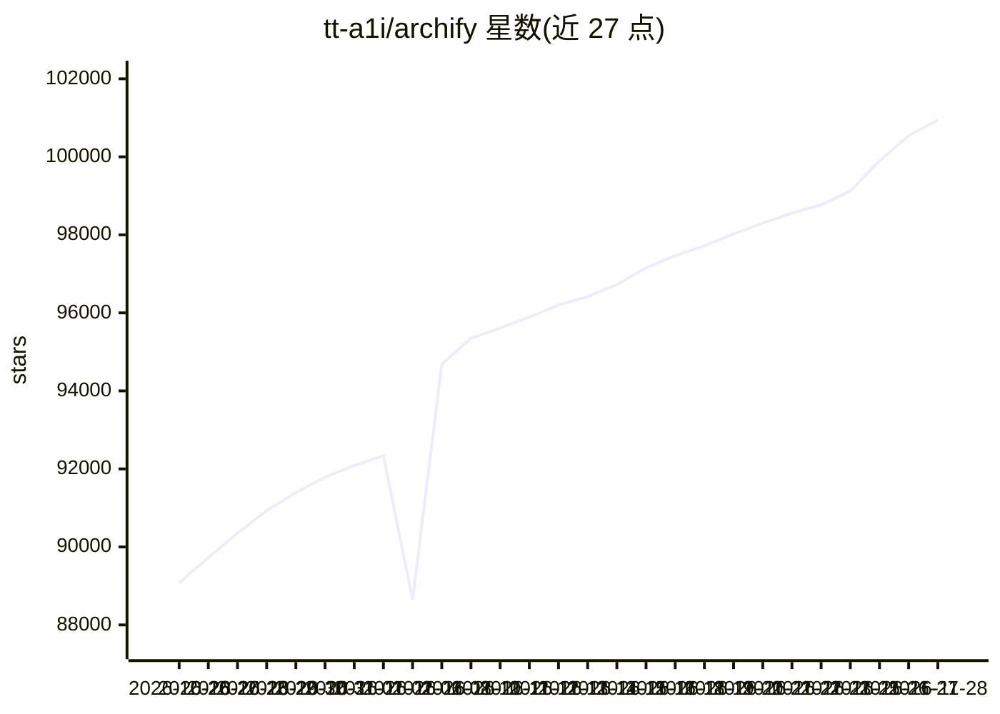

# tt-a1i/archify

⭐ 100,945 · JavaScript · Apache-2.0 · 推送 2026-11-27 · [GitHub](https://github.com/tt-a1i/archify) · [官网](https://archify.si) · 个人维护 · 中文 README

**把想法或代码库变成交互式图表的 Agent Skill**

一个面向编程 Agent 的 Skill：用户向 Agent（Claude Code、Codex、Cursor、OpenCode 等）描述想法、问题或让其读取代码库，Archify 生成可交互的单文件 HTML 图表或单页答案页。支持 10 种图表类型、4 种风格的 explainer 页、架构诊断（依赖环、耦合模块、复杂度热点，覆盖 JS/TS、Python、Java、Go、Rust、C/C++）、1080p 故事视频导出与 PR/MR 讲解。输出为自包含 HTML，浏览器打开即可交互，无需安装 Archify。Apache 2.0 许可。

## 筛选速览

| 维度 | 判定 | 备注 |
|---|---|---|
| AI 角色 | `ai-native` | 本体是模型或模型工具 |
| 许可风险 | `permissive` | Apache-2.0 |
| 部署形态 | `library` | 以包/库形式分发 |
| 模型依赖 | — | README 未给出锁定关系 |
| 硬件要求 | — | 无带数字的原话,不猜 |
| 安装摩擦 | `low` | 无编译、无系统依赖或容器化 |
| 成熟度 | — | 结构信号不足 |

## 动量与使用信号

- 维护:`active` — 距上次 push 0.7 天,年发版 22,84 位贡献者
- 涨星:近 1 天 **+571**(自 20261016 起算)
- 安装:npm 包 `skills` 月下载 23,786,800

## 能力要点

- 10 种图表类型与 4 种风格的单页答案（explainer）
- 架构诊断：依赖环、耦合、复杂度热点，支持 6 类语言，输出离线 HTML
- 故事视频导出 1080p/60fps（WebM/MP4）与 PR/MR 图上标注
- 输出为自包含 HTML，查看无需安装

## 适用场景

- 让 Agent 读取仓库生成带来源引用的架构图
- 排查 API 延迟等问题并得到单页诊断报告
- 为 PR 生成图上标注的变更讲解
- 把旅行计划等想法做成可交互页面分享

## 场景标签

`代码审查` `代码生成` · 领域:编码与开发

## 证据(README 行号)

> L3:  Turn anything you want to understand, plan, or share into an interactive visual.
> L9:  Start with an idea, a question, or a plan. Describe it to your AI agent, and Archify turns it into an interactive H

## 星数曲线

2026-10-26 89,076 → 2026-11-28 100,945（+11,869）

---
*卡片 v1 · prompt 1.4 · 生成 2026-11-26 · 置信度 high · 依据 README sha `c0bb2f1bc160` · [字段定义](../../DATASET.md)*
