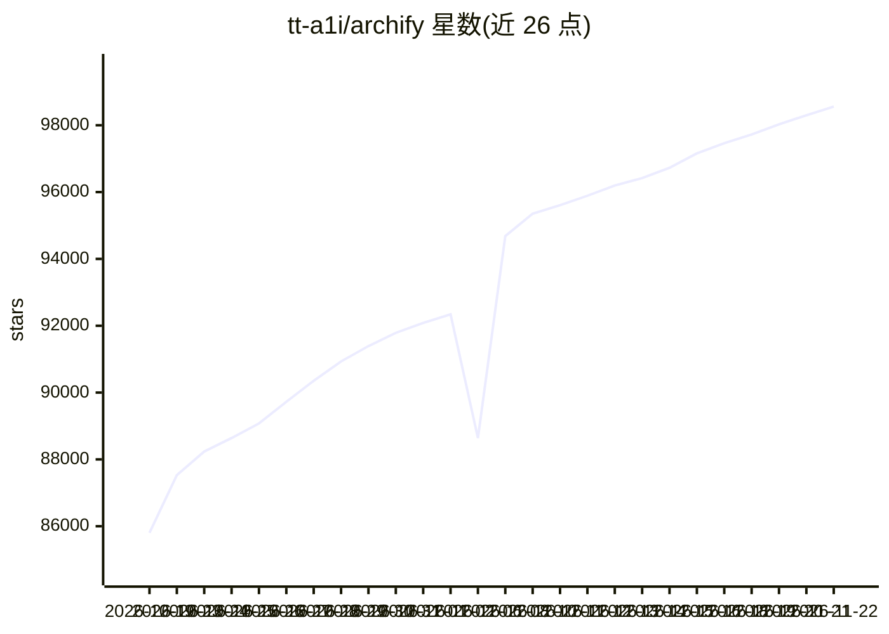

# tt-a1i/archify

⭐ 98,560 · JavaScript · Apache-2.0 · 推送 2026-11-21 · [GitHub](https://github.com/tt-a1i/archify) · [官网](https://archify.si) · 个人维护 · 中文 README

**让 AI agent 把想法或代码库生成为交互式图表的技能**

Archify 是一个面向 Claude Code、Codex、Cursor、OpenCode 等 coding agent 的技能（skill）：用户用自然语言描述想法、计划或让 agent 读取仓库，agent 据此生成可交互的 HTML 图表或单页解释页（explainer）。输出为自包含 HTML 文件，含节点详情、路径追踪、明暗主题切换、PNG/WebP/JPG 长图与 PDF 导出、路线分享卡；解释页中声明附编号来源、仓库摘录固定到 commit。支持通过 llms.txt、npx skills 或 DSH 插件方式安装，带可选的更新检查（可用环境变量关闭）。

## 筛选速览

| 维度 | 判定 | 备注 |
|---|---|---|
| AI 角色 | `ai-native` | 本体是模型或模型工具 |
| 许可风险 | `permissive` | Apache-2.0 |
| 部署形态 | `library` | 以包/库形式分发 |
| 模型依赖 | — | README 未给出锁定关系 |
| 硬件要求 | — | 无带数字的原话,不猜 |
| 安装摩擦 | `low` | 无编译、无系统依赖或容器化 |
| 成熟度 | — | 结构信号不足 |

## 动量与使用信号

- 维护:`active` — 距上次 push 0.7 天,年发版 22,84 位贡献者
- 涨星:近 1 天 **+571**(自 20261016 起算)
- 安装:npm 包 `skills` 月下载 23,786,800

## 能力要点

- 从描述或仓库生成自包含 HTML 交互图表，无需安装即可在浏览器查看
- explainer 单页模式：结论先行、声明附编号来源、仓库摘录固定到 commit
- 支持 npx skills / DSH 插件安装，覆盖 cursor、codex、claude-code、opencode 四种 agent
- 导出 PNG/WebP/JPG 长图、PDF 打印及路线分享卡

## 适用场景

- 让 agent 读取仓库生成带源码出处的运行时架构图
- 把一段流程描述变成可探索、可分享的交互图表
- 生成旅行行程、学习地图等自定义交互页面
- 向 agent 提问并获得结论先行的单页解释

## 场景标签

`代码生成` · 领域:编码与开发

## 证据(README 行号)

> L9:  Start with an idea, a question, or a plan. Describe it to your AI agent, and Archify turns it into an interactive H
> L26:  Works with Claude Code, Codex, Cursor, and OpenCode
> L45: Works with Cursor, Claude Code, Codex CLI, and OpenCode. See installation options below for additional integrations

## 星数曲线

2026-10-19 85,805 → 2026-11-22 98,560（+12,755）

---
*卡片 v1 · prompt 1.4 · 生成 2026-11-22 · 置信度 high · 依据 README sha `e0e6fbeb9a0f` · [字段定义](../../DATASET.md)*
