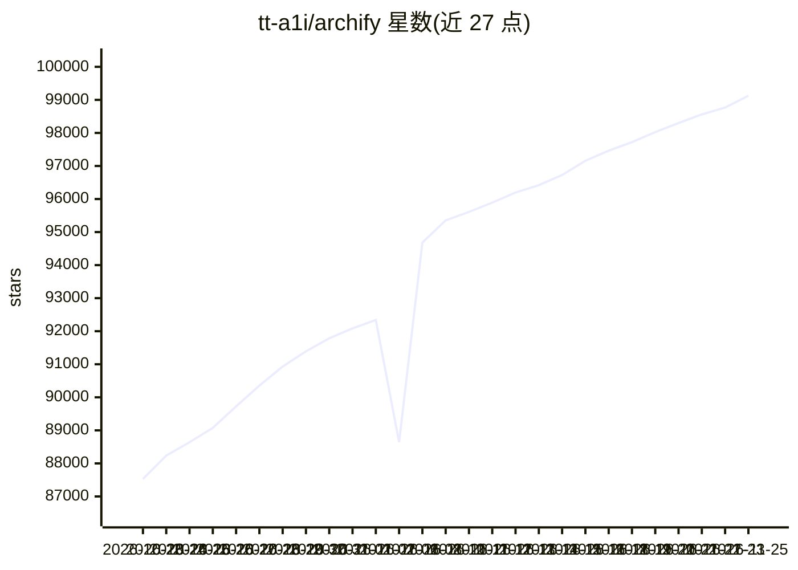

# tt-a1i/archify

⭐ 99,124 · JavaScript · Apache-2.0 · 推送 2026-11-23 · [GitHub](https://github.com/tt-a1i/archify) · [官网](https://archify.si) · 个人维护 · 中文 README

**面向编码 agent 的交互式图表生成技能**

Archify 是一个安装到 AI 编码 agent（Claude Code、Codex CLI、Cursor、OpenCode 等）中的开源技能：用户用自然语言描述想法、计划或仓库，agent 生成可交互的单文件 HTML 图表，支持节点点击、源码链接、路径追踪、主题切换，并可导出 PNG/WebP/JPG 与 PDF。附加能力包括将复杂回答整理为图表式解释页（explainer）、仓库架构诊断（依赖环、耦合、热点）、图表故事视频与 PR/MR 评注（可选 archify-pr 技能）。无需仓库即可从描述生成；查看产物不需要安装 Archify。Apache 2.0 许可，版本 3.3.0。

## 筛选速览

| 维度 | 判定 | 备注 |
|---|---|---|
| AI 角色 | `ai-ecosystem` | LLM/agent 周边工具 |
| 许可风险 | `permissive` | Apache-2.0 |
| 部署形态 | `library` | 以包/库形式分发 |
| 模型依赖 | — | README 未给出锁定关系 |
| 硬件要求 | — | 无带数字的原话,不猜 |
| 安装摩擦 | `low` | 无编译、无系统依赖或容器化 |
| 成熟度 | — | 结构信号不足 |

## 动量与使用信号

- 维护:`active` — 距上次 push 0.7 天,年发版 22,84 位贡献者
- 涨星:近 1 天 **+571**(自 20261016 起算)
- 安装:npm 包 `skills` 月下载 23,786,800

## 能力要点

- 将想法、计划或仓库生成为自包含的交互式 HTML 图表
- 仓库架构诊断：依赖环、耦合模块、复杂度热点（支持 JS/TS、Python、Java、Go、Rust、C/C++）
- 图表可导出 PNG/WebP/JPG/PDF 及 1080p 60fps 故事视频
- 可在 GitHub PR / GitLab MR 上附加明暗两种图表做变更标注

## 适用场景

- 让 agent 读取仓库生成带源码出处、锚定 commit 的架构图
- 排查性能问题时让 agent 输出结论优先的单页解释报告
- 为 PR 评审生成标注变更位置的交互式图示
- 把旅行计划、学习路线等非代码内容做成可交互页面

## 场景标签

`代码生成` `代码审查` · 领域:编码与开发

## 证据(README 行号)

> L9:  Start with an idea, a question, or a plan. Describe it to your AI agent, and Archify turns it into an interactive H
> L26:  Works with Claude Code, Codex, Cursor, and OpenCode
> L132:  CODE ANALYSIS · Built into the Skill, no extra install

## 星数曲线

2026-10-23 87,529 → 2026-11-25 99,124（+11,595）

---
*卡片 v1 · prompt 1.4 · 生成 2026-11-24 · 置信度 high · 依据 README sha `8764dd05c7df` · [字段定义](../../DATASET.md)*
