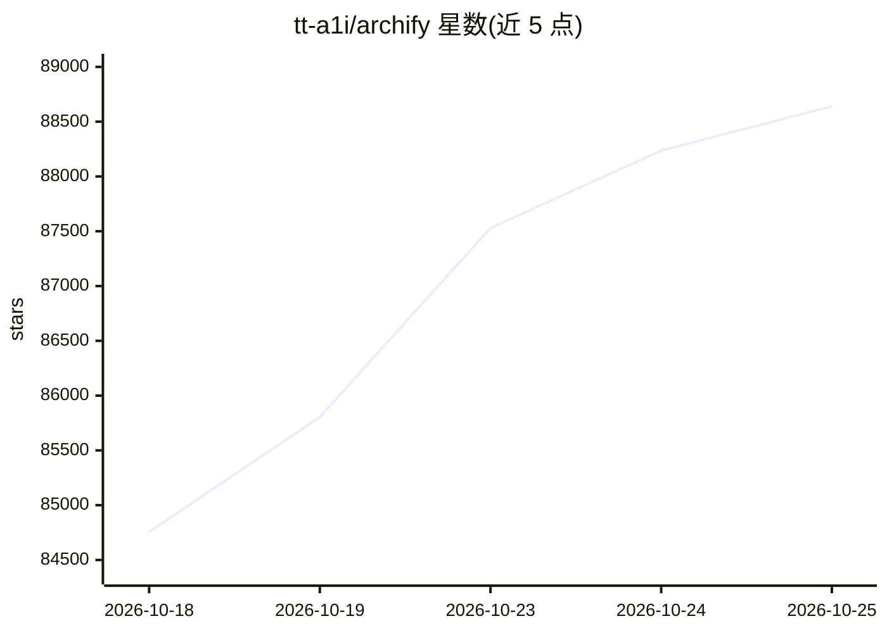

# tt-a1i/archify

⭐ 88,640 · JavaScript · MIT · 推送 2026-10-24 · [GitHub](https://github.com/tt-a1i/archify) · [官网](https://archify.si) · 个人维护 · 中文 README

**给编码 Agent 的交互式图表生成技能，将描述或代码库转为可交互 HTML**

以 agent skill 形式分发的可视化工具：安装后由 Claude Code、Codex、Cursor、OpenCode 等编码代理调用，将一句话描述、计划或代码仓库分析结果生成为自包含的交互式 HTML 架构图/流程图，支持主题切换、PNG/WebP 导出与路径分享卡；亦可生成带引用来源的'explainer'单页问答。仓库源码追踪固定到 commit。产物为独立 HTML，查看无需安装 Archify。通过 npx skills 安装，含更新检查（可禁用）。

## 筛选速览

| 维度 | 判定 | 备注 |
|---|---|---|
| AI 角色 | `ai-ecosystem` | LLM/agent 周边工具 |
| 许可风险 | `permissive` | MIT |
| 部署形态 | `library` | 以包/库形式分发 |
| 模型依赖 | — | README 未给出锁定关系 |
| 硬件要求 | — | 无带数字的原话,不猜 |
| 安装摩擦 | `low` | 无编译、无系统依赖或容器化 |
| 成熟度 | — | 结构信号不足 |

## 动量与使用信号

- 维护:`active` — 距上次 push 0.7 天,年发版 22,84 位贡献者
- 涨星:近 1 天 **+571**(自 20261016 起算)
- 安装:npm 包 `skills` 月下载 23,786,800

## 能力要点

- 将描述或代码库转为可交互 HTML 图（explainer/架构图/流程图）
- 源码引用固定到 commit，声明配编号来源
- 产物为自包含 HTML，查看端无需安装
- 兼容 Claude Code、Codex、Cursor、OpenCode，npx skills 一键安装

## 适用场景

- 让编码代理读我的仓库并生成可探索的架构图
- 把一句话描述变成可分享的交互式流程图/学习地图
- 生成结论先行的单页技术问答（含引用与验证图表）

## 场景标签

 · 领域:开发工具/可视化

## 证据(README 行号)

> L26:  Works with Claude Code, Codex, Cursor, and OpenCode
> L45: Works with Cursor, Claude Code, Codex CLI, and OpenCode. See installation options below for additional integrations
> L48: npx skills add tt-a1i/archify -g

## 星数曲线

2026-10-18 84,756 → 2026-10-25 88,640（+3,884）

---
*卡片 v1 · prompt 1.4 · 生成 2026-10-20 · 置信度 high · 依据 README sha `58c5c89cf3c1` · [字段定义](../../DATASET.md)*
