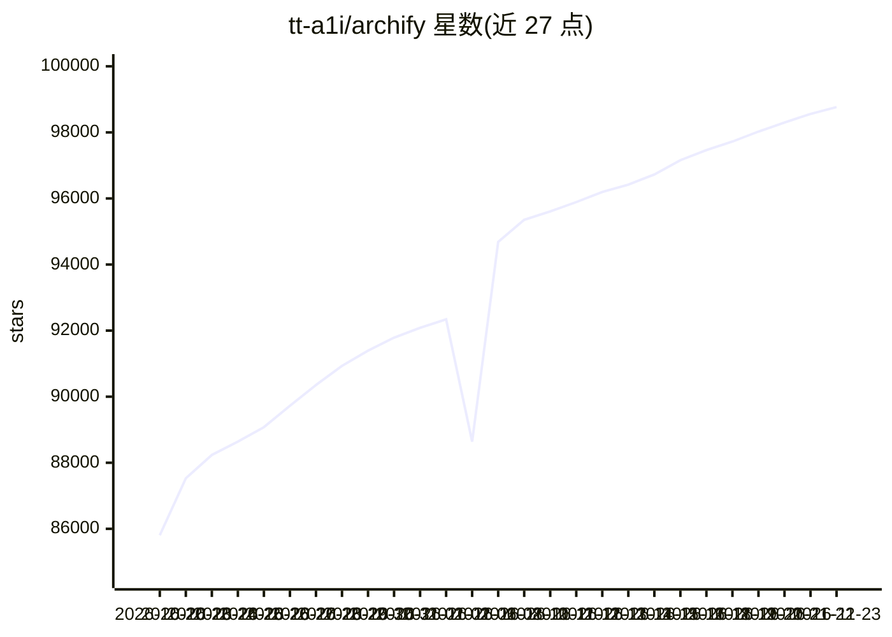

# tt-a1i/archify

⭐ 98,767 · JavaScript · Apache-2.0 · 推送 2026-11-22 · [GitHub](https://github.com/tt-a1i/archify) · [官网](https://archify.si) · 个人维护 · 中文 README

**让编码 Agent 把想法/代码库变成可交互架构图的技能**

一个面向 AI 编码代理（Claude Code、Codex CLI、Cursor、OpenCode 等）的技能包：用户用一句话描述想法或让 Agent 读取仓库，生成可探索、可分享的自包含交互式 HTML 图表。功能包括带来源引用的架构图（钉住 commit、可回链源码）、仓库依赖分析与诊断（依赖环、耦合热点，支持 JS/TS、Python、Java、Go、Rust、C/C++）、解释页（explainer）模式、Story 视频导出与 PR/MR 评注。Apache-2.0 许可，查看输出无需安装本产品。

## 筛选速览

| 维度 | 判定 | 备注 |
|---|---|---|
| AI 角色 | `ai-native` | 本体是模型或模型工具 |
| 许可风险 | `permissive` | Apache-2.0 |
| 部署形态 | `library` | 以包/库形式分发 |
| 模型依赖 | — | README 未给出锁定关系 |
| 硬件要求 | — | 无带数字的原话,不猜 |
| 安装摩擦 | `low` | 无编译、无系统依赖或容器化 |
| 成熟度 | — | 结构信号不足 |

## 动量与使用信号

- 维护:`active` — 距上次 push 0.7 天,年发版 22,84 位贡献者
- 涨星:近 1 天 **+571**(自 20261016 起算)
- 安装:npm 包 `skills` 月下载 23,786,800

## 能力要点

- 读取仓库生成带 commit 锚定来源引用的架构图
- 内置架构诊断：依赖环、耦合模块、复杂度热点、分层规则违规
- 输出单文件离线 HTML，支持 PNG/WebP/JPG 导出与 1080p 故事视频
- 通过 llms.txt 一句话指令即可让 Agent 完成安装

## 适用场景

- 让 Agent 读取陌生仓库，生成带源码链接的系统地图
- 诊断项目的模块耦合与依赖循环并交给 Agent 修复
- 把复杂问题答成一页可分享的解释页
- 在 PR/MR 上附上标注变更的架构图

## 场景标签

 · 领域:开发者工具/代码可视化

## 证据(README 行号)

> L9:  Start with an idea, a question, or a plan. Describe it to your AI agent, and Archify turns it into an interactive H
> L138: **Architecture Diagnosis** reads a repository and shows how it actually hangs together: dependency cycles, tightly
> L46: Works with Cursor, Claude Code, Codex CLI, and OpenCode. See installation options below for additional integrations

## 星数曲线

2026-10-20 85,805 → 2026-11-23 98,767（+12,962）

---
*卡片 v1 · prompt 1.4 · 生成 2026-11-23 · 置信度 high · 依据 README sha `2442ac6c4d77` · [字段定义](../../DATASET.md)*
