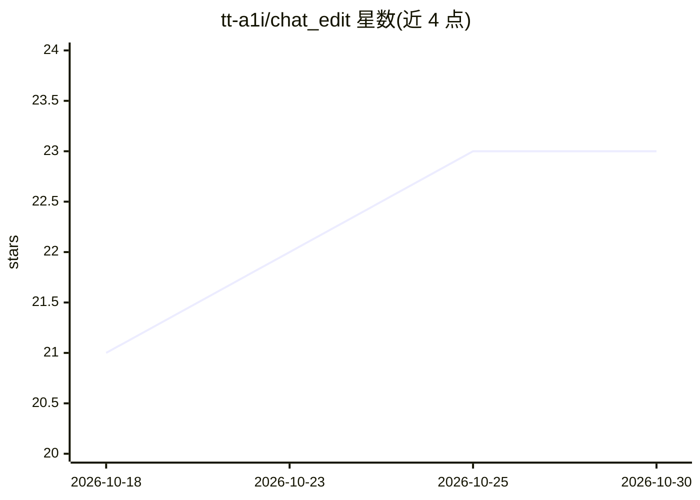

# tt-a1i/chat_edit

⭐ 23 · TypeScript · MIT · 推送 2026-03-01 · [GitHub](https://github.com/tt-a1i/chat_edit) · 个人维护 · 中文 README

**双模式 AI 应用：流式对话聊天 + 富文本 AI 编辑**

基于 Vue 3.5 + TypeScript 构建的双模式 AI 应用：聊天场景提供流式 Markdown 渲染、Mermaid 图表、多会话管理与导入导出；AI 编辑场景基于 Quill 2.0 富文本编辑器，支持润色、改写、翻译、代码生成、摘要提取，Monaco 差异对比视图，可导出 PDF/DOCX/Markdown/HTML。AI 服务通过 Moonshot AI API（SSE 流式）接入，需配置 API key。数据以 IndexedDB（Dexie.js）本地存储，面向终端用户，从源码通过 pnpm 运行。

## 筛选速览

| 维度 | 判定 | 备注 |
|---|---|---|
| AI 角色 | `ai-native` | 本体是模型或模型工具 |
| 许可风险 | `permissive` | MIT |
| 部署形态 | `None` |  |
| 模型依赖 | — | README 未给出锁定关系 |
| 硬件要求 | — | 无带数字的原话,不猜 |
| 安装摩擦 | `low` | 无编译、无系统依赖或容器化 |
| 成熟度 | — | 结构信号不足 |

## 能力要点

- 实时流式 Markdown 渲染，支持 Mermaid 图表与代码高亮
- Quill 2.0 富文本编辑 + AI 处理（润色/改写/翻译/代码生成/摘要）
- Monaco Editor 差异对比视图，多格式导出（PDF/DOCX/MD/HTML）
- IndexedDB 离线优先本地存储，53 个单元测试 + E2E 测试

## 适用场景

- 与 AI 流式对话并渲染 Markdown/图表回复
- 在富文本编辑器中用 AI 润色、改写、翻译文稿
- 对比 AI 修改前后的差异并导出为多种格式文档

## 场景标签

`聊天机器人` `AI 写作` `代码生成` · 领域:编码与开发

## 证据(README 行号)

> L3:  A dual-mode AI application combining chat and rich-text AI editing
> L59:  AI &#26381;&#21153; Moonshot AI API (SSE streaming)

## 星数曲线

2026-10-18 21 → 2026-10-30 23（+2）

---
*卡片 v1 · prompt 1.4 · 生成 2026-10-27 · 置信度 high · 依据 README sha `248492c6c751` · [字段定义](../../DATASET.md)*
