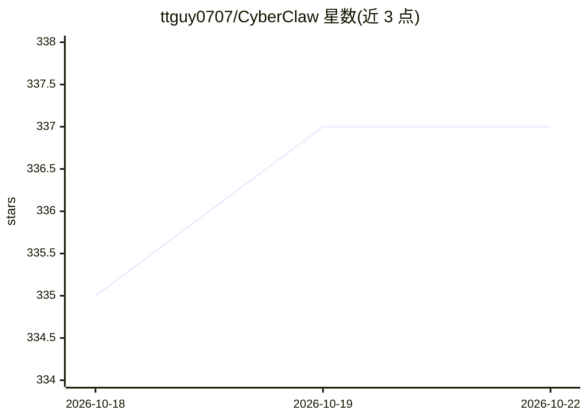

# ttguy0707/CyberClaw

⭐ 338 · Python · MIT · 推送 2026-09-10 · [GitHub](https://github.com/ttguy0707/CyberClaw) · 个人维护 · 中文 README

**给开发者的 LangGraph 通用智能体 CLI：可审计决策与两段式技能调用**

以 Python 和 LangGraph 实现的单机 CLI 智能体：围绕“模型决策→工具行动→结果观察”构建状态图，提供 SQLite 会话持久化、Markdown 用户画像、上下文压缩、13 个内置工具、定时心跳任务、子 Agent 委派与 5 类 JSONL 行为日志。核心机制是 help→run 两段式动态技能调用：help 返回一次性凭据，run 前由代码校验会话、技能身份与说明哈希，过期/重放/跨会话均拒绝。模型工厂支持 OpenAI 兼容接口及 Anthropic、Ollama 可选分支（未经真实 API 回归验证）。限制：Shell 使用宿主权限非 OS 沙盒，日志截断不保证完整回放，子图不持久化。

## 筛选速览

| 维度 | 判定 | 备注 |
|---|---|---|
| AI 角色 | `ai-ecosystem` | LLM/agent 周边工具 |
| 许可风险 | `permissive` | MIT |
| 部署形态 | `library` | 以包/库形式分发 |
| 模型依赖 | local-ok | 支持本地模型 |
| 硬件要求 | — | 无带数字的原话,不猜 |
| 安装摩擦 | `low` | 无编译、无系统依赖或容器化 |
| 成熟度 | — | 结构信号不足 |

## 能力要点

- help→run 两段式技能调用，凭据绑定会话/技能/内容 SHA-256，300 秒有效、原子消费
- 子 Agent 委派：预设 code_reviewer/document_analyst 角色或临时定义，工具白名单宿主校验
- SQLite checkpoint 会话持久化 + 40/10 回合水位上下文压缩与 LLM 摘要合并
- 5 类 JSONL 行为日志 + cyberclaw monitor 终端监控

## 适用场景

- 在命令行运行带会话记忆与定时任务的个人智能体
- 通过两段式凭据校验约束动态技能的执行顺序
- 委派子 Agent 做代码审查或文档分析并汇总结果

## 场景标签

 · 领域:LLM 智能体框架

## 证据(README 行号)

> L5: **基于 LangGraph 的通用智能体：可观察的决策、可扩展的技能、执行前的协议校验**
> L15: CyberClaw 受 OpenClaw 启发，以 Python 和 LangGraph 实现通用智能体工作流。项目围绕“模型决策 → 工具行动 → 结果观察”构建状态图，提供 SQLite 会话持久化、用户画像、上下文摘要、动态

## 星数曲线

2026-10-18 335 → 2026-10-22 337（+2）

---
*卡片 v1 · prompt 1.4 · 生成 2026-10-21 · 置信度 mid · 依据 README sha `75e4a0fdf3d1` · [字段定义](../../DATASET.md)*
