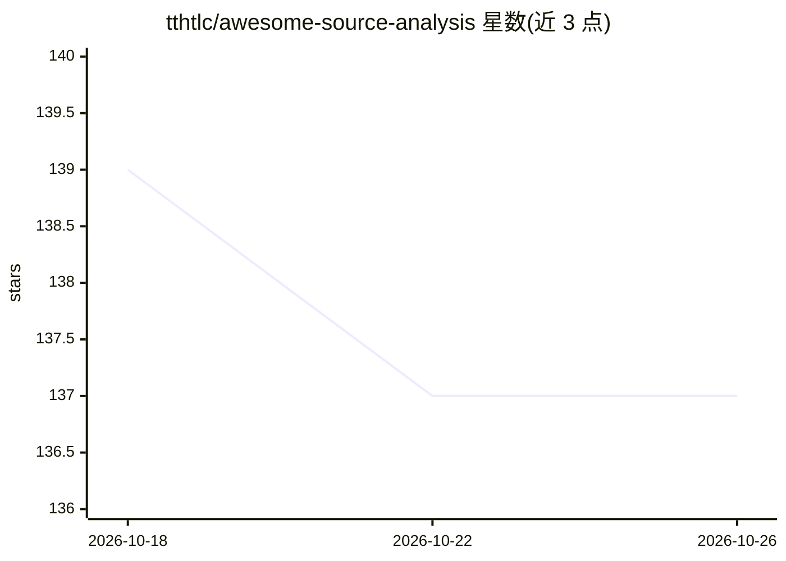

# tthtlc/awesome-source-analysis

⭐ 137 · 推送 2026-01-18 · [GitHub](https://github.com/tthtlc/awesome-source-analysis) · 个人维护

**机器学习源码分析资源清单：汇集相关技术与应用资料**

由 Peter Teoh 个人维护的资源聚合清单，收录用于源码分析（source code analysis）的机器学习资料，涵盖深度学习、PCA、SVM、贝叶斯、概率模型、强化学习等技术类别。条目按目录组织，支持社区贡献与分享。README 仅提供清单框架与维护者信息，未提供代码库、安装方式或运行入口。

## 筛选速览

| 维度 | 判定 | 备注 |
|---|---|---|
| AI 角色 | `ai-knowledge` | 知识聚合/清单类 |
| 许可风险 | `none` | — |
| 部署形态 | `None` |  |
| 模型依赖 | — | README 未给出锁定关系 |
| 硬件要求 | — | 无带数字的原话,不猜 |
| 安装摩擦 | `low` | 无编译、无系统依赖或容器化 |
| 成熟度 | — | 结构信号不足 |

## 能力要点

- 收录源码分析领域的机器学习技术资料
- 覆盖深度学习、SVM、贝叶斯、概率模型、强化学习等多类方法
- 提供目录结构与社区贡献入口

## 适用场景

- 查找用机器学习做源码分析的论文与工具资料
- 了解该交叉领域的资料分布

## 场景标签

`精选清单` · 领域:学习与行业

## 证据(README 行号)

> L1: # Awesome Source Code Analysis Via Machine Learning Techniques
> L3: A list of resources for source code analysis application using Machine Learning techniques (eg, Deep Learning, PCA, 

## 星数曲线

2026-10-18 139 → 2026-10-26 137（-2）

---
*卡片 v1 · prompt 1.4 · 生成 2026-10-22 · 置信度 mid · 依据 README sha `fde95b84f2fc` · [字段定义](../../DATASET.md)*
