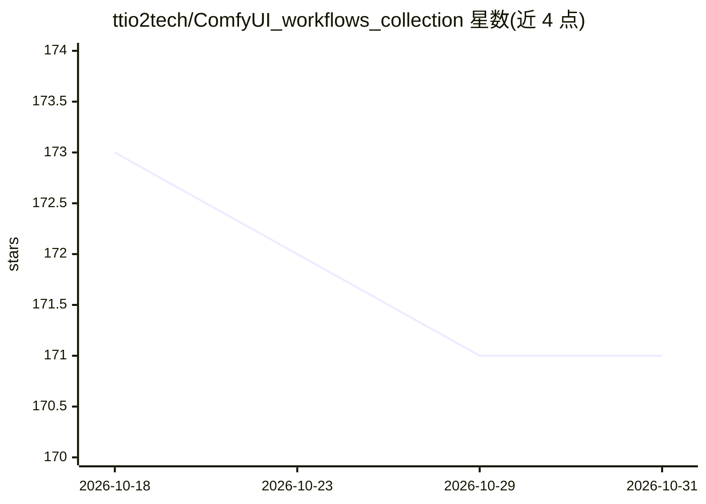

# ttio2tech/ComfyUI_workflows_collection

⭐ 171 · 推送 2026-09-23 · [GitHub](https://github.com/ttio2tech/ComfyUI_workflows_collection) · [官网](https://agireact.com/workflow-download) · 个人维护

**ComfyUI 工作流合集：文生图/图生图/文生视频的可用 workflow 文件**

收录大量 ComfyUI 工作流文件（.json/.png），覆盖文生图、图像编辑、文生视频/图生视频（Qwen Image、Wan 2.1/2.2、Flux、HunyuanVideo、LTX 等），部分工作流标注支持 Nvidia、AMD 或 Mac 运行，多数配有视频教程链接。使用方式为下载工作流文件后拖入 ComfyUI 加载，需自行下载 checkpoint 模型并安装缺失的自定义节点。面向已使用 ComfyUI 的图像/视频生成用户。

## 筛选速览

| 维度 | 判定 | 备注 |
|---|---|---|
| AI 角色 | `ai-knowledge` | 知识聚合/清单类 |
| 许可风险 | `none` | — |
| 部署形态 | `None` |  |
| 模型依赖 | — | README 未给出锁定关系 |
| 硬件要求 | — | 无带数字的原话,不猜 |
| 安装摩擦 | `low` | 无编译、无系统依赖或容器化 |
| 成熟度 | — | 结构信号不足 |

## 能力要点

- 覆盖 Qwen Image、Wan 2.x、Flux、HunyuanVideo 等模型的工作流文件
- 部分工作流标注支持 Nvidia、AMD 或 Mac（含 MacBook 版本）
- 多数工作流附视频教程，含 LoRA 训练指南
- 使用方式为拖入 .json/.png 文件到 ComfyUI 加载

## 适用场景

- 下载现成工作流直接在 ComfyUI 中生成图像或视频
- 参照教程学习特定模型的 ComfyUI 工作流搭建
- 在低显存、AMD 或 Mac 设备上运行对应版本工作流

## 场景标签

`图像生成` `视频生成` `教程课程` · 领域:内容生成

## 证据(README 行号)

> L3: This repo is a collection of ComfyUI workflows. Most of them have been covered in video tutorials (see below).
> L15: * Qwen Image 2.1 text to image and Image edit

## 星数曲线

2026-10-18 173 → 2026-10-31 171（-2）

---
*卡片 v1 · prompt 1.4 · 生成 2026-10-22 · 置信度 high · 依据 README sha `25cb8b723e7d` · [字段定义](../../DATASET.md)*
