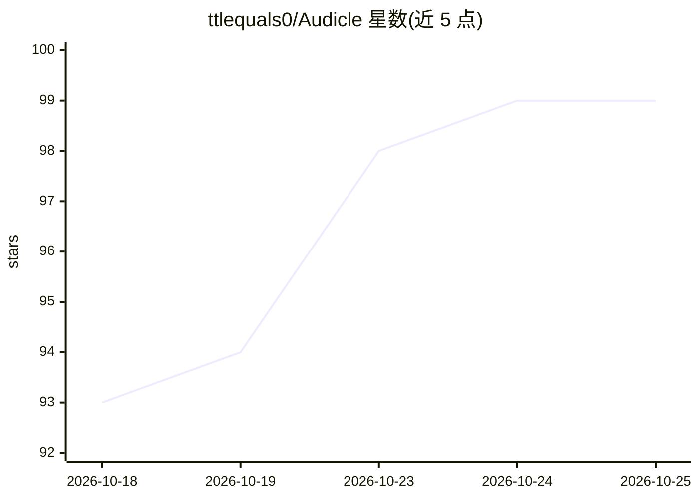

# ttlequals0/Audicle

⭐ 99 · Python · NOASSERTION · 推送 2026-10-24 · [GitHub](https://github.com/ttlequals0/Audicle) · 个人维护

**把收藏文章转成自托管播客的自建服务**

自托管的 Podcasting 2.0 服务：粘贴 URL 或上传文档（含扫描 PDF、DOCX、Markdown、HTML、图片），经提取流水线生成带克隆语音朗读、章节、封面、LLM 撰写的单集摘要与 WebVTT 字幕的播客节目，输出可被 Pocket Casts、Overcast、Apple Podcasts 订阅的 RSS 源。后端为 FastAPI + SQLite，TTS 使用 Chatterbox（独立 GPU 容器），无 GPU 时可 CPU 运行但更慢。通过 Docker Compose 部署，Web UI 兼作 PWA。注意 Chatterbox 输出携带 Resemble PerTh 水印且无法关闭。

## 筛选速览

| 维度 | 判定 | 备注 |
|---|---|---|
| AI 角色 | `ai-native` | 本体是模型或模型工具 |
| 许可风险 | `none` | NOASSERTION |
| 部署形态 | `self-host` | docker 或自建部署 |
| 模型依赖 | — | README 未给出锁定关系 |
| 硬件要求 | `cpu-ok` | |
| 安装摩擦 | `low` | 无编译、无系统依赖或容器化 |
| 成熟度 | — | 结构信号不足 |

## 能力要点

- 多格式输入（URL/PDF/DOCX/Markdown/HTML/图片）转为带章节与字幕的播客单集
- 语音克隆朗读，TTS 由 Chatterbox 独立容器提供
- LLM 生成单集摘要
- 支持 CPU-only 部署

## 适用场景

- 通勤时用自己的克隆语音收听收藏的文章
- 在 Apple Podcasts 等播客客户端订阅自建阅读列表频道
- 保持阅读列表与语音数据自托管、不依赖第三方音频平台

## 场景标签

`语音合成` `文档解析` · 领域:内容生成

## 证据(README 行号)

> L7: Paste a URL or upload a document (PDF including scanned, DOCX, Markdown, text, HTML, or an image), wait a few minute
> L88: tts-wrapper/    TTS model server (Chatterbox; separate GPU container)

## 星数曲线

2026-10-18 93 → 2026-10-25 99（+6）

---
*卡片 v1 · prompt 1.4 · 生成 2026-10-23 · 置信度 high · 依据 README sha `89eba0cf706d` · [字段定义](../../DATASET.md)*
