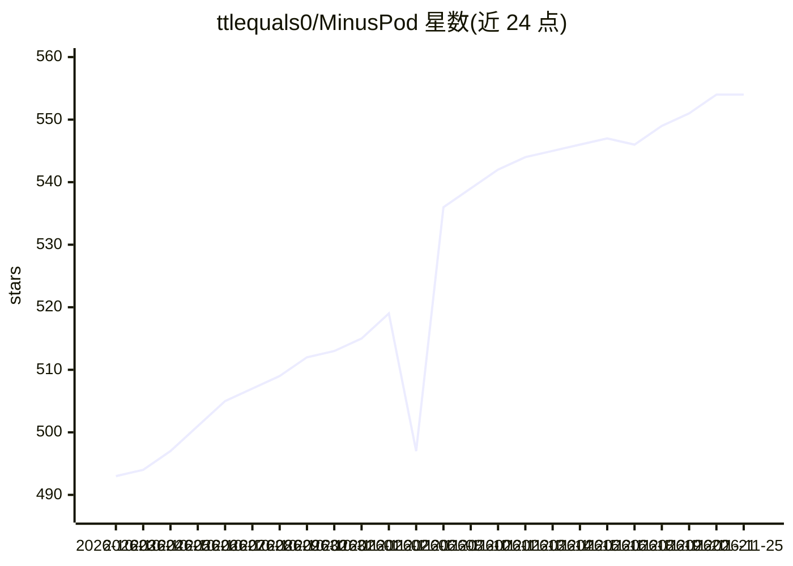

# ttlequals0/MinusPod

⭐ 554 · Python · MIT · 推送 2026-11-23 · [GitHub](https://github.com/ttlequals0/MinusPod) · [官网](minuspod.app) · 个人维护

**自托管播客服务器：播放前用 LLM 转录并剪除广告**

自托管服务器，在播放前从播客与 YouTube 节目中剪除广告：指向 RSS 订阅、播放列表或频道，转录在本地（faster-whisper、Parakeet、GPU/CPU）或远程 API 完成，LLM 在转录文本中定位广告段并由 FFmpeg 剪切，二次校验确认边界。用户的修正会沉淀为跨集模式，命中重复赞助商时无需再次调用 LLM。YouTube 音频经 yt-dlp 下载，SponsorBlock 标记决定剪点；LLM 可设为 None，改用音频线索、指纹与文本模式运行。提供 Web UI、REST API、加密备份与 Docker 部署。

## 筛选速览

| 维度 | 判定 | 备注 |
|---|---|---|
| AI 角色 | `ai-native` | 本体是模型或模型工具 |
| 许可风险 | `permissive` | MIT |
| 部署形态 | `None` |  |
| 模型依赖 | local-ok | 支持本地模型 |
| 硬件要求 | — | 无带数字的原话,不猜 |
| 安装摩擦 | `medium` | 含编译或系统依赖之一 |
| 成熟度 | `idea` | |

## 能力要点

- LLM 定位广告 + 二次校验 + 可选人工复核队列（波形编辑器）
- 本地转录支持 faster-whisper 与 NVIDIA Parakeet，也可走远程 API
- 修正沉淀为跨集模式，重复赞助商无需再次 LLM 调用
- 支持无 LLM 模式（LLM_PROVIDER=none），仅用音频线索与 SponsorBlock

## 适用场景

- 订阅播客 RSS，自动剪除赞助商广告后再收听
- 把 YouTube 播放列表转成去广告的播客订阅源
- 自托管端点上离线队列运行 LLM 处理
- 仅用音频线索和指纹在无 LLM 环境下去广告

## 场景标签

 · 领域:媒体/音频处理

## 证据(README 行号)

> L3: MinusPod is a self-hosted server that strips ads from podcasts and YouTube shows before you hit play. Point it at an
> L25: - Transcribe locally with faster-whisper or NVIDIA Parakeet on GPU or CPU, or remotely through whisper.cpp, Groq, O
> L53: The transcriber turns the episode into text, an LLM marks the ad segments, FFmpeg cuts them, and Flask serves the m

## 星数曲线

2026-10-23 493 → 2026-11-25 554（+61）

---
*卡片 v1 · prompt 1.4 · 生成 2026-11-25 · 置信度 high · 依据 README sha `ae3d743632a2` · [字段定义](../../DATASET.md)*
