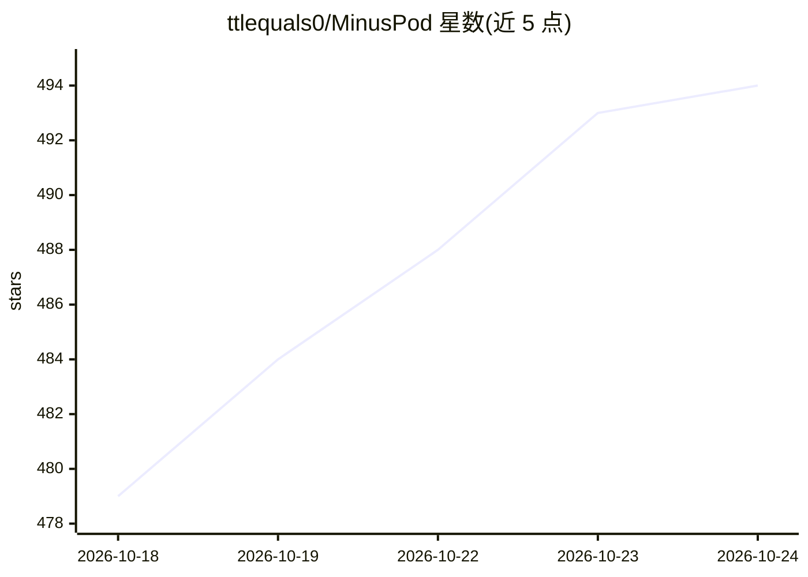

# ttlequals0/MinusPod

⭐ 494 · Python · MIT · 推送 2026-10-23 · [GitHub](https://github.com/ttlequals0/MinusPod) · 个人维护

**自托管播客服务器：本地转录+LLM 在播放前去广告**

自托管 Docker 服务，订阅播客 RSS 后在服务器端处理：用 faster-whisper 或 NVIDIA Parakeet 本地转录（或远程 API），LLM 在转录文本上检测广告段落，FFmpeg 剪切后经 Flask 发布改写版 RSS 与音频。LLM 供应商可自带（Anthropic/OpenRouter/Ollama/System One/任意 OpenAI 兼容端点），运行时可切换。支持从用户纠正中跨集学习广告模式、可选社区模式同步，提供 Web UI、REST API、成本统计与加密备份。要求 Docker，GPU 为推荐非必需。声明仅限个人使用且需有权修改对应播客。

## 筛选速览

| 维度 | 判定 | 备注 |
|---|---|---|
| AI 角色 | `ai-native` | 本体是模型或模型工具 |
| 许可风险 | `permissive` | MIT |
| 部署形态 | `desktop` | 安装包/桌面程序 |
| 模型依赖 | local-ok | 支持本地模型 |
| 硬件要求 | — | 无带数字的原话,不猜 |
| 安装摩擦 | `medium` | 含编译或系统依赖之一 |
| 成熟度 | — | 结构信号不足 |

## 能力要点

- 本地转录（faster-whisper/Parakeet，GPU 或 CPU）+ LLM 广告段检测 + FFmpeg 剪切流水线
- LLM 供应商自带且运行时可切换：Anthropic/OpenRouter/Ollama/System One/OpenAI 兼容端点，含 A/B 路由与故障转移
- 从用户纠正中跨集学习广告模式（播客级/网络级/全局），可选社区模式同步
- 发布改写 RSS：章节、重生成转录、Podcasting 2.0 标签、OPML 导入导出

## 适用场景

- 自托管订阅播客，播放前自动剪掉广告段落
- 用自己的 LLM（如 Ollama 本地推理）跑广告检测，控制 API 成本
- 把自有音频文件构建为本地 feed 并走同一去广告流水线
- 在手机播客客户端中通过改写后的 RSS 订阅无广告版本

## 场景标签

`语音识别` · 领域:感知与多模态

## 证据(README 行号)

> L3: MinusPod is a self-hosted server that removes ads from podcasts before you ever hit play. It transcribes episodes lo
> L64: The transcriber (faster-whisper, Parakeet, or a remote API) transcribes the episode, an LLM finds the ad segments i

## 星数曲线

2026-10-18 479 → 2026-10-24 494（+15）

---
*卡片 v1 · prompt 1.4 · 生成 2026-10-21 · 置信度 high · 依据 README sha `92e0202fc788` · [字段定义](../../DATASET.md)*
