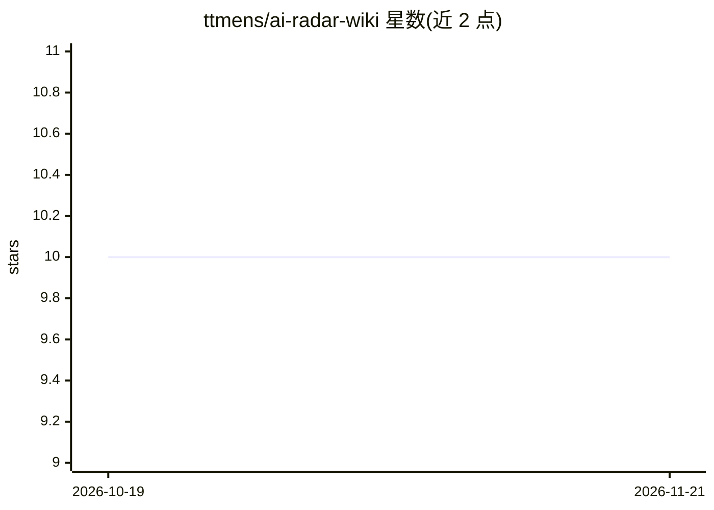

# ttmens/ai-radar-wiki

⭐ 10 · HTML · MIT · 推送 2026-11-20 · [GitHub](https://github.com/ttmens/ai-radar-wiki) · [官网](https://ttmens.github.io/ai-radar-wiki/graph.html) · 个人维护 · 中文 README

**面向 AI 产品经理的自动化 AI 情报知识库与图谱**

一个自动化更新的 AI 技术情报系统，面向 AI 产品经理，每 4 小时更新一次。内容组织为四个支柱：技术能力、产品模式、工具生态、商业动态，共含 10,703 个节点与 11,838 条边，其中 41% 附中文摘要。提供交互式知识图谱、图谱数据（graph.json）、Wiki 索引、RSS 订阅与今日日报等访问入口，README 未展示本地部署或构建说明。

## 筛选速览

| 维度 | 判定 | 备注 |
|---|---|---|
| AI 角色 | `ai-knowledge` | 知识聚合/清单类 |
| 许可风险 | `permissive` | MIT |
| 部署形态 | `None` |  |
| 模型依赖 | — | README 未给出锁定关系 |
| 硬件要求 | — | 无带数字的原话,不猜 |
| 安装摩擦 | `low` | 无编译、无系统依赖或容器化 |
| 成熟度 | — | 结构信号不足 |

## 能力要点

- 四支柱结构：技术能力/产品模式/工具生态/商业动态
- 每 4 小时自动更新，含 10,703 节点与 11,838 边
- 提供 RSS 订阅、日报与交互式知识图谱入口
- 41% 节点带中文摘要

## 适用场景

- 跟踪新模型、算法与技术突破动态
- 了解 AI 工具生态的框架、SDK 与平台
- 查阅 AI 领域融资与产品发布等商业动态

## 场景标签

`知识库管理` `知识图谱` · 领域:知识与检索

## 证据(README 行号)

> L3: > 自动化 AI 技术情报系统，面向 AI 产品经理的 4 支柱知识图谱
> L21: |支柱|节点数|说明|

## 星数曲线

2026-10-19 10 → 2026-11-21 10（+0）

---
*卡片 v1 · prompt 1.4 · 生成 2026-11-19 · 置信度 mid · 依据 README sha `cbd584ce726f` · [字段定义](../../DATASET.md)*
