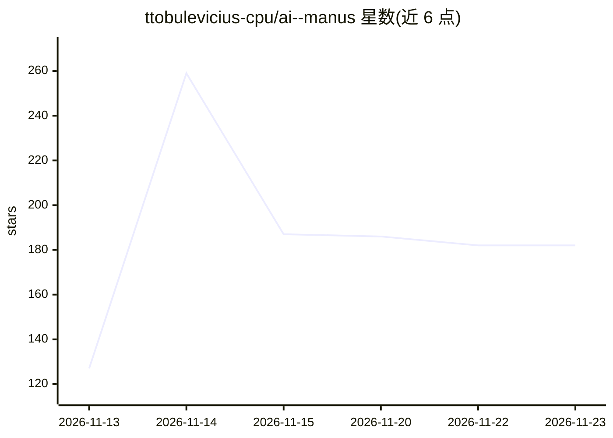

# ttobulevicius-cpu/ai--manus

⭐ 182 · Apache-2.0 · 推送 2026-11-15 · [GitHub](https://github.com/ttobulevicius-cpu/ai--manus) · 个人维护

**面向日常任务的自主 AI 代理：自行执行代码与控制浏览器**

Manus 定位为自主 AI 代理，代表用户编写并执行脚本、控制浏览器完成多步骤任务（导航网页、填表、收集信息），可在后台作为个人助手处理学习、家庭与轻量办公场景中的重复性事务。README 以功能介绍、兼容性配置表与使用步骤为主，面向非开发者用户；未提供具体的安装命令、代码仓库结构或模型接入方式等实现细节。主题标签中含 anthropic、openai、gemeni、ai-sdk 等词，但正文未见对应接入说明。

## 筛选速览

| 维度 | 判定 | 备注 |
|---|---|---|
| AI 角色 | `ai-native` | 本体是模型或模型工具 |
| 许可风险 | `permissive` | Apache-2.0 |
| 部署形态 | `None` |  |
| 模型依赖 | — | README 未给出锁定关系 |
| 硬件要求 | — | 无带数字的原话,不猜 |
| 安装摩擦 | `low` | 无编译、无系统依赖或容器化 |
| 成熟度 | — | 结构信号不足 |

## 能力要点

- 自主执行代码与浏览器控制，支持脚本与网页操作衔接的多步任务
- 以个人助手形式在后台运行，处理重复性日常任务
- 面向家庭、学习与小规模场景，声明无需开发者背景

## 适用场景

- 让代理自动跑脚本和打开网页完成小任务
- 整理研究资料、填写重复表单、汇总多页面信息
- 在后台委派日常琐碎任务以减少手动操作

## 场景标签

`AI 助手` `浏览器自动化` `编码 Agent` · 领域:效率与自动化

## 证据(README 行号)

> L10: - **Autonomous Code Execution:** Manus AI agent runs code on its own to complete tasks, so you can focus on decisio
> L18: Manus is an autonomous AI agent designed to run code and control a browser on your behalf. Instead of acting like a

## 星数曲线

2026-11-13 127 → 2026-11-23 182（+55）

---
*卡片 v1 · prompt 1.4 · 生成 2026-11-17 · 置信度 low · 依据 README sha `0f78ee3a5dd2` · [字段定义](../../DATASET.md)*
