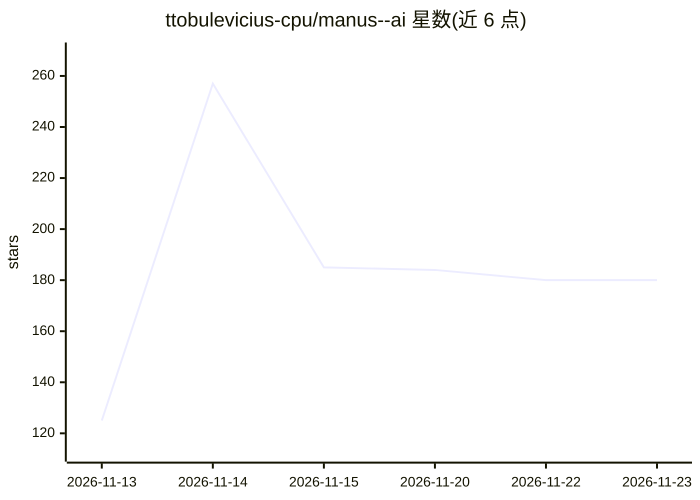

# ttobulevicius-cpu/manus--ai

⭐ 180 · Apache-2.0 · 推送 2026-11-15 · [GitHub](https://github.com/ttobulevicius-cpu/manus--ai) · 个人维护

**面向个人日常任务的自主 AI Agent：代用户写代码并控制浏览器**

Manus 是一个自主 AI Agent 系统，在沙箱环境中运行工具与操作：可自行编写并执行脚本、控制浏览器（导航网页、填表、采集信息），完成多步骤任务，需少量监督。README 将其定位为面向家庭、学习与轻量办公场景的个人助手，而非企业平台或重型套件。文档仅描述功能、兼容性表与使用步骤，未给出具体安装命令、模型接入方式或代码实现细节。

## 筛选速览

| 维度 | 判定 | 备注 |
|---|---|---|
| AI 角色 | `ai-native` | 本体是模型或模型工具 |
| 许可风险 | `permissive` | Apache-2.0 |
| 部署形态 | `None` |  |
| 模型依赖 | — | README 未给出锁定关系 |
| 硬件要求 | — | 无带数字的原话,不猜 |
| 安装摩擦 | `low` | 无编译、无系统依赖或容器化 |
| 成熟度 | — | 结构信号不足 |

## 能力要点

- 自主编写并执行代码完成任务
- 浏览器控制：导航网页、填写表单、采集信息
- 代码与浏览器操作可在同一工作流中衔接
- 跨会话记住工作流模式并可重复应用

## 适用场景

- 学习与研究中收集资料、运行小脚本、整理笔记
- 家庭与轻量办公中处理重复性网页操作
- 开发与测试中快速运行小实验而无需搭建完整环境

## 场景标签

`AI 助手` `编码 Agent` `浏览器自动化` · 领域:效率与自动化

## 证据(README 行号)

> L10: - **Autonomous Code Execution:** Manus AI agent runs code on its own to complete tasks, so you can focus on decisio
> L18: Manus is an autonomous AI agent designed to run code and control a browser on your behalf. Instead of acting like a
> L22: Manus is not a heavy studio suite or a complex enterprise platform. It is a focused helper built for home, study, a

## 星数曲线

2026-11-13 125 → 2026-11-23 180（+55）

---
*卡片 v1 · prompt 1.4 · 生成 2026-11-17 · 置信度 mid · 依据 README sha `0f78ee3a5dd2` · [字段定义](../../DATASET.md)*
