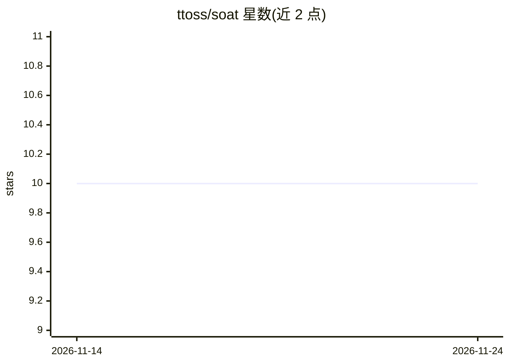

# ttoss/soat

⭐ 10 · TypeScript · Apache-2.0 · 推送 2026-11-24 · [GitHub](https://github.com/ttoss/soat) · [官网](https://soat.ttoss.dev) · 个人维护

**自托管 Node.js 服务器：为 AI agent 应用提供生产基础设施**

SOAT 是一个可自托管的开源 Node.js 服务器，为构建 AI 应用提供基础设施层：IAM 与 API 密钥、基于 pgvector 的文档/记忆语义检索、多模态摄取、agent 编排、DAG 多智能体工作流、RAG、护栏与人工审批、用量计量与配额、带金丝雀发布的版本化 agent、评估门控晋升，以及内置 OAuth 2.1 的 MCP 服务器。所有操作通过 REST、MCP、CLI、TypeScript SDK 与 Web 控制台五个等效入口暴露，数据层依赖 PostgreSQL。面向搭建 AI 应用的开发者，Apache 2.0 许可。

## 筛选速览

| 维度 | 判定 | 备注 |
|---|---|---|
| AI 角色 | `ai-ecosystem` | LLM/agent 周边工具 |
| 许可风险 | `permissive` | Apache-2.0 |
| 部署形态 | `self-host` | docker 或自建部署 |
| 模型依赖 | — | README 未给出锁定关系 |
| 硬件要求 | — | 无带数字的原话,不猜 |
| 安装摩擦 | `low` | 无编译、无系统依赖或容器化 |
| 成熟度 | — | 结构信号不足 |

## 能力要点

- 五等效入口：REST、MCP、CLI、TypeScript SDK、Web 控制台
- pgvector 支撑的文档与记忆语义搜索，多模态摄取（OCR/语音/视觉）
- 护栏确定性分类 agent 工具调用，风险动作进入人工审批队列
- append-only agent 版本、金丝雀发布与 eval 门控晋升

## 适用场景

- 为自建 AI 应用一站式补齐用户、存储、密钥与追踪基础设施
- 通过 MCP 让 Claude Desktop/Cursor 连接受管理的 agent 与工具
- 对 agent 变更做评估门控与金丝雀灰度发布
- 用 DAG 编排将 agent、工具与知识查询串成多智能体工作流

## 场景标签

`多智能体` `RAG` `Agent 框架` · 领域:Agent 开发

## 证据(README 行号)

> L10: **SOAT** is open-source infrastructure for building AI applications. One self-hostable Node.js server gives you IAM
> L16: Shipping AI applications means rebuilding the same infrastructure on every project: users, API keys, encrypted secr

## 星数曲线

2026-11-14 10 → 2026-11-24 10（+0）

---
*卡片 v1 · prompt 1.4 · 生成 2026-11-19 · 置信度 high · 依据 README sha `28df8d4e3a7e` · [字段定义](../../DATASET.md)*
